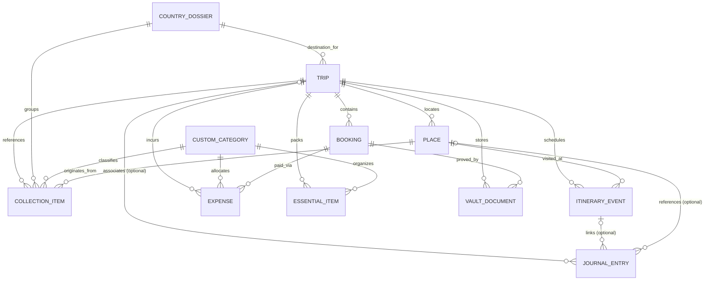
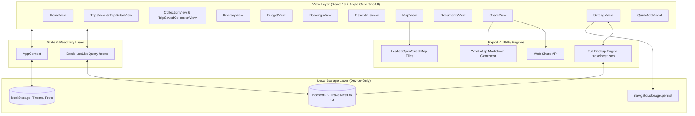

# Complete Product Requirements Document (PRD): TravelNest

## 1. Document Information

* **Product Name:** TravelNest
* **Version:** 2.6.0 (Travel Companion, Multi-Leg Transit, Recipe Library & Offline Directions)
* **Date:** October 14, 2026
* **Target Platform:** Mobile-First Android Native APK (Capacitor), iOS & PWA with Monochrome Voyage / Cupertino Editorial Design System
* **Author:** Luha Saniyya & DeepMind Engineering Team
* **Codebase Repository:** `TravelNest v2`

---

## 2. Executive Summary

TravelNest is a private, local-first personal travel organization and planning application designed for meticulous travelers, aspirational collectors, and memory archivists. Operating entirely without mandatory cloud backends, subscriptions, or remote database dependencies, TravelNest unifies early destination research, country dossiers, day-by-day itinerary scheduling, a three-tier financial ledger with group debt settlement, reservations management, packing checklists, an offline document vault, WhatsApp companion sharing, and an **independent Travel Memory Journal** into a cohesive, high-performance workspace.

In Release v2.3.0 through v2.4.1, TravelNest institutes a **Permanent Release Safety, Backward Compatibility & Local Data Preservation Mandate**:
1. **Permanent In-Place Android APK Update Preservation:** Confirms that updating an existing TravelNest APK installation on Android preserves 100% of the user's stored trips, itineraries, bookings, receipts, packing checklists, vault documents, photos, country collections, memories, and profile preferences without data loss.
2. **Stable Android Application Identity & WebView Origin:** Formally locks the Android Application ID (`com.travelnest.app`), namespace, and Capacitor WebView server scheme (`server.androidScheme: 'https'`). Locking the origin to `https://localhost` guarantees that Chromium WebView IndexedDB storage paths are never partitioned or reset across APK builds.
3. **Sequential Versioning & Signing Continuity:** Establishes mandatory rules for incrementing `versionCode` (incremented to `2`) and `versionName` (`"2.4.0"`), and enforces strict keystore certificate continuity to prevent Android Package Manager `INSTALL_FAILED_UPDATE_INCOMPATIBLE` or downgrade rejections.
4. **Explicit Backward-Aware Schema Migrations (Dexie v6):** Formalizes Dexie.js versioning principles. Database versions 1 through 6 are equipped with transactional `.upgrade()` hooks supplying safe non-destructive defaults (`country`, `category`, `isFavorite`, `tags`, `isSample`), and `initializeDatabaseSafely()` reports transient storage locks without silent database resets.
5. **Enhanced Backup Architecture (Format v4):** Extends `.travelnest.json` exports to incorporate `userProfile` (display name, avatar, home country, currency, travel styles) alongside all 11 relational tables, with bidirectional backward compatibility for v3 imports.
6. **Provenance-Tracked Dummy-Data Removal:** Introduces a dedicated "Remove Dummy Data" action in Settings that selectively and safely deletes only unedited records created by the "Add Dummy Data" feature. Uses deterministic sample IDs, baseline structural comparison, and explicit `isEdited` tracking—never guessing based on record names. Protects all personal user data and subsequent user edits to sample records. Previews removable vs preserved counts in a Cupertino modal with explicit user confirmation. Keeps App Reset completely separate.
7. **Safe Trip Deletion & Non-Destructive Detachment:** Overhauls trip deletion logic so deleting a trip never destroys saved collection items or journal memories. Saved places/items are detached (`tripId: undefined`), assigned to their destination country dossier in `db.countries`, and preserved in Collection inbox with all photos, notes, and tags intact. Journal entries are unlinked (`tripId: undefined`, `itineraryEventId: undefined`), preserving their full narrative, date, tags, photos, and location context. All other trip-specific records (itinerary events, bookings, expenses, checklists, documents) are cleanly deleted within an atomic Dexie transaction without leaving orphaned references.
8. **Authoritative Collection-Trip Association & Safe Reconciliation (v2.4.1):** Establishes an authoritative single source of truth selector (`getCollectionItemTripAssociation`) and startup reconciliation protocol (`reconcileCollectionAssociations`) that resolves the contradictory UI state where collection items displayed a green "Assigned to Trip" top badge while simultaneously presenting as unassigned "Global Field Note" in the trip association section. Collection folder membership (e.g., `country: 'Kazakhstan'`) is strictly uncoupled from trip association; country names or trip destinations never infer trip links. Eliminates auto-matching heuristics and hardcoded creation statuses. Top badge and trip association sections derive strictly from verified relational links, offering explicit "Assign to Trip", "Change Trip" (via Cupertino `AssignTripModal`), and "Remove from Trip" actions with zero user data loss.

The application is built on React 19, TypeScript, Dexie.js (IndexedDB v6), and Tailwind CSS, wrapped in an Apple iOS Cupertino / Monochrome Voyage aesthetic.

---

## 3. Product Vision & Philosophy

### 3.1 Product Vision
To provide a private, enduring, and connected digital travel journal where travelers maintain complete sovereignty over their data. The application empowers users to capture scattered ideas from social media and blogs, assemble structured trips, execute schedules without cellular connectivity, record personal memories and photographs independently of trip itineraries, and share formatted plans with companions effortlessly.

### 3.2 Core Product Principles
1. **User Autonomy Over Automation:** The application advises (e.g., detecting itinerary time overlaps or budget overruns) but never automatically modifies, deletes, or rearranges user itineraries or memory archives.
2. **Local-First & Offline Resilience:** All core data resides directly on the device in IndexedDB. Network access is strictly an enhancement (external map links), never a prerequisite for reading, writing, editing, or exporting data.
3. **Independent Memory Archiving:** A journal entry is a first-class memory record that does not require a trip, an itinerary activity, a date within a planned trip, or a photograph. Memories from years ago or everyday reflections are fully supported.
4. **Connected Normalized Records:** Information is recorded once and linked across domains. A Place or Saved Item connects seamlessly to Itinerary days, Bookings, and Expense payments without data duplication.
5. **Zero Cloud Maintenance & Extreme Privacy:** Zero tracking scripts, zero remote telemetry, zero recurring database costs, and zero lock-in. Full database backup and restore is handled client-side via JSON.
6. **Tactile Editorial Aesthetic:** Clean typography, micro-labels, inset grouped cards, and Apple-grade segmented controls that mirror a physical traveler's field notebook.
7. **Permanent Update Continuity:** Updates must never treat existing user data as disposable. An app update is an enhancement of features, not a reset of state.

---

## 4. Evolution & Upgrade Matrix (Initial PRD vs. Finalized Release)

| Domain / Feature | Initial Stage Requirement (Draft v1.0) | Finalized Implementation (Release v2.1) | Status |
| :--- | :--- | :--- | :--- |
| **Design Language** | Generic responsive mobile layout with basic CSS utilities. | **iOS Cupertino Design Engine:** SF font stack, glassmorphic bottom navigation, inset grouped cards, segmented controls, modal sheets, and status countdown badges. | ✅ Implemented |
| **Home Dashboard** | Simple upcoming trip card and static text links. | **Context-Aware Workspace:** Dynamic departure countdown, dual metric cards (Total Outlay vs. Budget, Packing Readiness gauge), recent field notes feed, **Recent Journal Memories feed**, and **+ Add Journal Entry** action. | ✅ Implemented |
| **Trip Hub & Navigation** | Flat list of trips with 6 top tabs in trip detail. | **Trip Command Center:** Status filtering (`All`, `Upcoming`, `Planning`, `Ongoing`, `Completed`), search filter, custom covers, cascade deletes, and **9 dedicated sub-tabs** (with Journal replacing Map). | ✅ Implemented |
| **Collections & Curation** | Unstructured global inbox for raw links and text. | **Country Dossiers Architecture:** Organized by country (Japan, Switzerland, etc.), category badges, multi-tag filtering, inline country creation, and direct "Schedule into Day" integration. | ✅ Implemented |
| **Itinerary Planner** | Linear vertical activity list. | **Chronological Timeline Engine:** Day-by-day pill tabs, custom category icons, reordering controls, **Overlap Conflict Advisory System (⚠️ badge)**, and 1-tap **Journal activity logging**. | ✅ Implemented |
| **Travel Journal** | Not supported (limited to trip itinerary notes). | **Complete Memory Journal Engine (`db.journalEntries` v5):** Standalone memory archiving (dating back years), optional `tripId` / `itineraryEventId` / `placeId` relationships, multi-photo attachments (Base64), mood tags, full CRUD, search, and "By Trip" grouping. | ✅ Implemented |
| **Financial Ledger** | Flat total expenses with single currency. | **3-Tier Financial Ledger:** Planned Budget vs. Committed Bookings vs. Actual Expenses with **Double-Counting Prevention**, Category Budgets allocation with warning banners, and **Personal Debts / IOUs tracker** (`i_owe` vs `they_owe`) with 1-tap settlement. | ✅ Implemented |
| **Custom Categories** | Hardcoded category lists for items and expenses. | **Extensible Custom Category Engine:** Multi-scope categories (`collection`, `expense`, `essential`) persisted in IndexedDB with custom emoji badges and labels. | ✅ Implemented |
| **Reservations & Bookings** | Simple text confirmation notes. | **Integrated Bookings Module:** Type-specific cards (Flight, Hotel, Train, Car Rental, Ticket), PNR/Confirmation tracking, status badges, and payment linking with expense deductions. | ✅ Implemented |
| **Packing & Essentials** | Basic static checklist. | **Categorized Essentials Manager:** Packing vs. Travel Document filters, progress ring/bar, 100% readiness celebratory badge, and on-the-fly custom packing categories. | ✅ Implemented |
| **Document Storage** | Noted as future OPFS roadmap. | **Offline Document Vault:** Client-side Base64 DataURL storage (up to 5MB per file), quick tag suggestions (Flight, Hotel, Visa, etc.), custom tags, and in-app document preview/download. | ✅ Implemented |
| **Sharing & Companion** | Raw plain-text clipboard copy. | **WhatsApp Formatting Engine & Web Share API:** Rich WhatsApp markdown builder with privacy toggles to mask/reveal booking codes, budgets, and notes. | ✅ Implemented |
| **Storage & Persistence** | Basic JSON dump concept. | **IndexedDB v5 + Storage Persistence:** `navigator.storage.persist()`, storage quota estimation in MB, JSON full database export (v4 schema including profile and journal), overwrite/merge import, and sample data reset. | ✅ Implemented |
| **First-Launch & Onboarding** | Direct jump to blank dashboard without orientation. | **Cupertino 4-Step Onboarding & Splash:** Smooth 600ms splash screen, brand philosophy, local profile setup (display name, avatar), preferences (home country, currency, travel style chips), and returning-user detection heuristic. | ✅ Implemented |
| **Guided App Tour** | Static help text or absent. | **Interactive Spotlight Product Tour (v2.5.0):** Multi-phase journey (Welcome -> Live Cutout Spotlight -> Completion). SVG mask cutout hole dims background while highlighting live controls (`nav-home`, `nav-trips`, `btn-create-trip`, `nav-collection`, `nav-journal`, `fab-quick-add`, `nav-settings`) with dynamic speech-bubble pointer tails, collision avoidance, and Settings reactivation. | ✅ Implemented |
| **Test Data Management** | Hardcoded initial auto-seed on fresh install. | **Deliberate Sample Dataset Seeding:** Genuinely clean new installs; complete rich dataset (Tokyo, Swiss Alps, Kazakhstan, collections, bookings, expenses, packing, documents, journals) available via Settings with "Safe Merge" vs "Replace" modes. | ✅ Implemented |
| **App Reset Safeguards** | Single destructive "Clear All" button. | **Multi-Tier App Reset Engine:** Granular 3-way reset choices (`Clear Travel Data Only`, `Reset Onboarding & Preferences Only`, `Full Factory Reset`) with explicit impact disclosure and safety confirmation. | ✅ Implemented |
| **First-Use Empty States** | Minimal or placeholder text. | **Editorial Contextual Empty States:** Thoughtful empty states across Home, Trips, Collections, and Journal providing clear next actions, guidance, and aesthetic elegance. | ✅ Implemented |
| **Android In-Place Updates** | Ad-hoc build without version constraints. | **Permanent In-Place Update Architecture:** Fixed Application ID (`com.travelnest.app`), stable WebView origin (`androidScheme: 'https'`), incremented `versionCode` (2) / `versionName` ("2.3.0"), explicit Dexie `.upgrade()` handlers, backup v4 format with user profile, and zero-wipe startup guarantee. | ✅ Implemented |
| **Dummy-Data Removal** | Absent (or destructive full database wipe). | **Provenance-Tracked Removal Engine:** Settings action that targets only records created by "Add Dummy Data". Strict ID registry & baseline delta checking (never guesses by name). Preserves personal data, user-created records, and user edits. Preview modal with breakdown + confirmation. Separate from App Reset. | ✅ Implemented |
| **Safe Trip Deletion** | Cascade deletion risked erasing saved collection items and memories. | **Non-Destructive Cascade Detachment:** Deleting a trip safely detaches saved collection items (`tripId: undefined`, sets status to inbox, maps to destination country dossier) and journal entries (`tripId: undefined`, preserves story, photos, tags, location context). Deletes only trip-specific events, bookings, expenses, packing, and documents cleanly in an atomic transaction. | ✅ Implemented |
| **Collection-Trip Association** | Contradictory UI state (green badge vs unassigned note); creation heuristics auto-matched trips by country name. | **Authoritative Single-Source Architecture & Safe Reconciliation (v2.4.1):** Unified `getCollectionItemTripAssociation` selector governing badge and trip section. Strictly decoupled country collections from trip associations. Removed auto-guessing. Added in-app `AssignTripModal` (Variant 08) and startup database reconciliation `reconcileCollectionAssociations()` without data loss. | ✅ Implemented |
| **Daily Travel Companion** | Fragmented itinerary, bookings, and budget tabs with no unified day briefing. | **Trip-Linked Daily Companion (`CompanionView.tsx`):** Unified day-by-day briefing combining daily itinerary events, active bookings, expenses, places, transit connections, and planned meals with quick-action logging. | ✅ Implemented |
| **Multi-Leg Transport & GTFS** | Single departure/arrival text fields. | **Multi-Leg Journey Planner & GTFS Importer:** Structured legs (`TransportLeg`) with duration, layovers, transfer warnings (<45m), and client-side GTFS static `.zip` & JSON timetable parsing via `JSZip`. | ✅ Implemented |
| **Recipe Library & Grocery Engine** | Unplanned food expenses without meal budgeting or grocery lists. | **Reusable Recipe Library & Ingredient Pricing Engine:** Global reusable recipes, base ingredient prices + trip overrides, servings scaler, meal slot planner, and grocery checklist with 1-tap ledger expense creation. | ✅ Implemented |
| **Offline Places & Directions** | External map links only, requiring active internet connection. | **Offline Saved Places & Compass Directions:** Coordinate display, Haversine distance, forward compass bearing, RFC 5870 `geo:` URI launcher, textual directions cues, and Leaflet map with offline fallback. | ✅ Implemented |
| **Record Pack Exchange** | All-or-nothing full database backup/restore. | **Selective Record Pack Exchange (`RecordExchangeModal.tsx`):** Portable single-trip and recipe pack exports (`.travelnest-pack.json`) with JSON validation and 3-way conflict resolution (`skip`, `overwrite`, `copy`). | ✅ Implemented |

---

## 5. Target Personas & Jobs to Be Done (JTBD)

### 5.1 Personas
1. **The Meticulous Explorer (Primary):** Plans complex multi-city vacations months in advance. Demands granular control over daily itineraries, time slots, confirmation codes, and category budget allocations.
2. **The Personal Memory Archivist:** Cherishes meaningful moments, spontaneous outings, and past adventures. Wants to record reflections and photos without being forced to create a full itinerary or trip.
3. **The Social Collector:** Discovers hidden restaurants and spots across Instagram, TikTok, and blogs. Needs an instantaneous capture mechanism to file ideas into country dossiers long before specific trip dates exist.
4. **The Group Trip Treasurer:** Coordinates logistics for companions. Tracks who paid for flights, splits shared dining, logs bilateral personal debts ("Alex owes Mia"), and exports clean itineraries directly to WhatsApp.

### 5.2 Jobs to Be Done (JTBD)
* **JTBD 1 (Instantaneous Memory Archiving):** *When I recall* a memorable moment from years ago or experience a spontaneous everyday event, *I want to* record a title, story, and photos in under 3 taps without creating a trip, *so that* my personal memories are preserved forever offline.
* **JTBD 2 (Contextual Itinerary Reflections):** *When I finish* an itinerary activity during an active trip, *I want to* log a journal memory linked to that specific activity with one tap, *so that* my impressions are woven directly into the trip log.
* **JTBD 3 (Spatial & Temporal Conflict Prevention):** *When I build* my day-by-day itinerary, *I want the system to* warn me if two activities overlap in time, *so that* I do not create an unrealistic schedule.
* **JTBD 4 (Financial Ledger Accuracy):** *When I log* a hotel booking for ₹25,000 and later record a ₹10,000 partial payment expense, *I want the system to* recognize the link *so that* my total outlay does not double-count the ₹10,000.
* **JTBD 5 (Offline Reliability):** *When I land* in an international airport with no cellular roaming or Wi-Fi, *I want to* open my booking confirmation codes, boarding passes, and day 1 directions instantly.

---

## 6. Information Architecture & Navigation Hierarchy

### 6.1 Top-Level Navigation (`MainNavTab`)
TravelNest employs a persistent iOS-style glassmorphic bottom navigation bar housing 5 primary destinations:
1. **Home (`home`):** Global overview, featured next trip countdown, financial and packing readiness metrics, recent field notes, **Recent Journal Memories feed**, and **+ Add Journal Entry** action.
2. **My Trips (`trips`):** Trip gallery with status filtering (`All`, `Upcoming`, `Planning`, `Ongoing`, `Completed`), search bar, and new trip creator.
3. **Collection (`collection`):** Country dossiers grid (Japan, Switzerland, Kazakhstan, etc.), deep-dive category filters, multi-tag search, and item curation.
4. **Journal (`journal`):** Dedicated personal memory archive dashboard. Features search across story text and tags, segmented views (`All Memories`, `By Trip`, `Favourites`), chronological sorting, tag filters, and **+ Add Journal Entry** creation trigger.
5. **Settings (`settings`):** Storage diagnostics, persistent storage authorization, JSON database backup/restore (v4 schema including user profile), Reusable Recipe Library, Selective Record Pack Exchange, sample data management, and factory reset.

*(Note: Map is removed from global bottom navigation; underlying saved places, addresses, and coordinates are preserved across collection dossiers and trip views with offline compass and directions support).*

### 6.2 Trip Workspace Sub-Navigation (`TripSubNavTab`)
When a user selects a trip from My Trips or the Home dashboard, the view transitions into a dedicated Trip Workspace equipped with 10 sub-navigation views:
1. **Overview (`overview`):** Hero photo banner, departure countdown badge, 3-metric quick stats (Schedule, Bookings, Packed), travelers chip, planned budget, highlights & notes, and quick action tiles.
2. **Companion (`companion`):** Active day-by-day companion briefing. Unifies daily scheduled activities, active check-ins & bookings, multi-leg transit journeys with layovers, meal plans with scalable servings, daily expense tallies, and offline landmark bearings.
3. **Saved (`saved`):** Contextual view displaying all saved collection items matching this trip's country or explicitly linked to the trip. Includes category filters, tag filters, and 1-tap "Schedule into Day" modal.
4. **Itinerary (`itinerary`):** Day-by-day pill tabs + "All Days" view, chronological event cards with start/end times, category badges, order reordering buttons, overlap conflict warning badges (⚠️), and direct **Journal** recording action on activities.
5. **Budget (`budget`):** Planned budget vs. Committed bookings vs. Actual expenses, Category budget allocations and overage warning banners, purchases list, and **Personal Debts / IOUs tracker** with 1-tap settlement.
6. **Bookings (`bookings`):** Reservations cards categorized by type (Flight, Hotel, Train, Car Rental, Ticket), PNR numbers, costs, payment statuses, and linked expense deductions.
7. **Essentials (`essentials`):** Grouped packing and travel document checklists, completion percentage bar, "100% Ready" status badge, and custom category creator.
8. **Journal (`journal`):** Trip-specific chronological memory log displaying exclusively entries linked to this trip (`entry.tripId === trip.id`), photo gallery, day/activity tags, and "+ Add Memory" prefilled action.
9. **Documents (`documents`):** Offline Document Vault containing Base64 attachments (PDFs, JPGs, PNGs), tag-based filtering, preview modals, and file downloads.
10. **Share (`share`):** Companion export engine generating structured WhatsApp text with privacy toggles to mask/show booking reference codes, budgets, and notes.

---

## 7. Detailed Screen Specifications & View Implementations

### 7.1 Screen 1: Home Dashboard (`HomeView.tsx`)
* **Header:** Clean, minimalist primary title `"Travel Workspace"` without distracting micro-labels, dates, or secondary action buttons.
* **Featured Trip Hero Card:**
  * Background cover image with dark gradient vignette.
  * Departure status badge: `"X Days Remaining"`, `"Departing Today"`, or `"Trip Active"`.
  * Status chip (`planning`, `upcoming`, `ongoing`).
  * Destination title, location pin, and date range (`formatDateRangeDDmmmYY`).
  * Inset footer with planned budget outlay and `"View Itinerary"` quick navigation button.
  * Empty state: Illustrated `"No Trips Scheduled"` card with a direct `"Create First Trip"` action button.
* **Dual Metrics Row:**
  * *Metric 1 (Total Outlay):* Sum of independent expenses + bookings vs. total planned budget outlay.
  * *Metric 2 (Packing Readiness):* Overall checklist percentage completed across all essentials (`packedCount / totalEssentials`).
* **Saved Field Notes Inset Group:** Preview of the 3 most recent collection items with custom category badge icons, title, country label, and a `"View All"` shortcut to the Collection tab. Tapping any listed Saved Field Note directly opens that specific note in its dedicated full-page `CollectionItemDetailView` (with Cupertino `< Back` navigation, Edit, Delete, hero cover, complete notes text, clickable web link, tags, and linked trip/place relationships).
* **Recent Journal Memories Inset Group:** Preview of the 3 most recent journal entries with thumbnail or neutral artistic placeholder, memory title, formatted date, location, and a `"View All"` shortcut to the Journal tab. Tapping an entry opens the dedicated full-page `JournalDetailView`.
* **Global Floating Action Button (FAB):** Persistent Quick Add button.

### 7.2 Screen 2: My Trips Hub (`TripsView.tsx`)
* **Header & Search:** Displays journey count and an instant search input filtering by country, title, or destination.
* **Segmented Filter Bar:** Horizontal scrollable control with dynamic count bubbles for `All`, `Upcoming`, `Planning`, `Ongoing`, and `Completed`.
* **Trip Card Stack:**
  * Rich card preview featuring country cover image, countdown badge, status chip, and destination metadata.
  * Footer displaying formatted date range, planned budget, traveler count, edit button, and cascading delete button.
* **Cascading Delete Confirmation:** Prompting confirmation before executing `db.deleteTripCascade(tripId)` to remove all child itinerary events, bookings, expenses, essentials, and documents, while safely unassigning collection items back to the general inbox.

### 7.3 Screen 3: Trip Creation & Editing (`TripsView.tsx` & `EditTripModal.tsx`)
* **Form Inputs:**
  * Trip Name / Title.
  * Country Dossier selector (with inline `"+ New Country"` creation persisting to `db.countries`).
  * Destination details.
  * Start Date and End Date pickers.
  * Status selector (`researching`, `planning`, `upcoming`, `ongoing`, `completed`, `archived`).
  * Planned budget in INR (`₹`).
  * Travelers input (comma-separated list, e.g., `"Alex (Me), Mia, Sam"`).
  * Trip Notes / Highlights textarea.
  * Cover Image: Local file upload via `FileReader` (up to 5MB DataURL) or automatic country preset cover assignment.

### 7.4 Screen 4: Trip Workspace Overview Sub-View (`TripDetailView.tsx`)
* **Navigation Bar:** `"Overview"` / `"My Trips"` back button and sticky top container.
* **Hero Header:** Displays trip status, days remaining, dates, and title.
* **Segmented Sub-Navigation:** 9 scrollable tabs with live count badges for Schedule, Budget, Bookings, Essentials, Saved, and Docs.
* **Quick Metrics Grid:** 3-column card grid showing Schedule event count, Bookings count, and Packed ratio.
* **Trip Details Card:** Planned budget figure, travelers list chip, date range, and comprehensive trip highlights/notes block.
* **Quick Actions Inset Group:** One-tap rows to capture notes/expenses, browse saved country spots, add an itinerary activity, or export to WhatsApp.

### 7.5 Screen 5: Saved Country Spots Sub-View (`TripSavedCollectionView.tsx`)
* **Context Awareness:** Automatically filters all global collection items to display only those belonging to the trip's destination country or directly assigned to the trip.
* **Filter Bar:** Category filter pills (`All`, `Food`, `Places`, `Stays`, `Activities`, `Shopping`, `Transport`, `Tips`), multi-tag selection chips, and instant search.
* **Saved Item Card:** Displays title, category badge, image thumbnail, notes, URL link, and an indication if the spot is already scheduled on a specific day (e.g., `"Scheduled on Day 2"`).
* **Schedule Into Itinerary Modal:**
  * Triggered via `"Schedule to Day"` button.
  * Select Day Number (Day 1 through Day N).
  * Configure Start Time and End Time.
  * Conflict Advisory: Live check warning if the selected time overlaps with an existing activity on that day.
  * One-tap save: Automatically creates an `ItineraryEvent` and marks the collection item as planned.

### 7.6 Screen 6: Itinerary Planner & Timeline (`ItineraryView.tsx`)
* **Day Navigation:** Horizontal pill selector (`All Days`, `Day 1`, `Day 2`, ..., `Day N`) with formatted calendar dates.
* **Chronological Timeline:**
  * Vertical timeline connecting events ordered by start time or manual order index.
  * Event cards featuring Start-End time badges, Category icon badge (`sightseeing`, `food`, `activity`, `lodging`, `travel`), title, location pin, and notes.
  * **Overlap Conflict Indicator (⚠️):** Renders a distinct warning banner if an event's time range overlaps with any other event on the same day (`eventA.startTime < eventB.endTime && eventA.endTime > eventB.startTime`).
  * Reorder controls (Up / Down) to manually sequence activities.
  * Edit and Delete action controls.
* **Add / Edit Activity Modal:** Comprehensive sheet configuring Day Number, Date, Start Time, End Time, Title, Location, Category, and Notes.

### 7.7 Screen 7: Budget & Financial Ledger (`BudgetView.tsx`)
* **Tab Switcher:** Toggle between `"Expenses & Purchases"` and `"Personal Debts & IOUs"`.
* **Budget Metrics Header:**
  * Planned Budget vs. Total Cost (Calculated using the **Double-Counting Prevention Rule**).
  * Remaining balance in INR (`₹`) and budget utilization progress bar.
  * Over-budget warning banner if Total Cost exceeds Planned Budget.
* **Category Budgets Allocation:**
  * Modal allowing users to allocate specific budget caps per category (e.g., Flights: ₹40,000, Food: ₹20,000, Lodging: ₹30,000).
  * System alerts when individual category expenditure exceeds its allocated budget.
* **Purchases Ledger:**
  * Grouped expense records showing Title, Category badge, Payer name (`paidBy`), Date, and Amount.
  * Linked Booking tag: Indicates if an expense is a payment toward a booking, deducting from that booking's balance without double-counting.
* **Personal Debts & IOUs Sub-Module:**
  * Tracks bilateral personal debts between travelers (e.g., `"I borrowed ₹1,200 from Mia"` or `"Sam owes me ₹3,500"`).
  * Direction selector: `i_owe` ("I owe them") vs. `they_owe` ("They owe me").
  * Net Summary Cards: Distinct cards displaying `"Total I Owe"` and `"Total Owed to Me"`.
  * One-tap Settle Up toggle: Marks debts as settled (`debtSettled: true`) with strikethrough styling and removes them from active balances.
* **Add Expense Modal:** Configures Entry Type (`purchase` vs `debt`), Title, Amount, Category (with inline custom category creation), Payer, Linked Booking selector, Date, and Notes.

### 7.8 Screen 8: Bookings & Reservations (`BookingsView.tsx`)
* **Filterable Cards:** Grouped by reservation type with distinctive icons (`Plane` for flights, `Building` for hotels, `Train` for rail, `Car` for car rental, `Ticket` for activities).
* **Card Details:** Provider name, Title, Confirmation / PNR reference number, Date range, Cost, Status badge (`confirmed`, `pending`, `cancelled`), and Notes.
* **Payment Tracking & Balance:** Automatically tracks associated expense payments linked via `bookingId`. Computes Paid Amount and Outstanding Balance.
* **Add Booking Modal:** Captures Type, Title, Provider, Reference Number, Cost, Status, Start Date, and Notes.

### 7.9 Screen 9: Essentials & Packing Manager (`EssentialsView.tsx`)
* **Segmented Filter:** Filter items by `All Items`, `Packing`, or `Travel Documents`.
* **Pack Progress Gauge:** Visual percentage progress bar (`packedCount / totalCount`). If 100% complete, displays a celebratory `"100% Ready"` pill badge.
* **Grouped Checklists:** Checklists organized by category (Clothing, Electronics, Toiletries, Documents, Finance, Medical, Gear, etc.).
* **Item Interaction:** One-tap toggle to mark items packed/unpacked with immediate reactive UI update.
* **Custom Category Creation:** Allows users to create custom packing categories on-the-fly with custom icons.

### 7.10 Screen 10: Travel Memory Journal Engine (`JournalView.tsx`, `JournalEntryModal.tsx`, `JournalDetailView.tsx`, `TripJournalView.tsx`)

#### 7.10.1 Global Journal Dashboard (`JournalView.tsx`)
* **Page Header:** Clean, minimalist primary title `"Travel Journal"` matching the `Travel Workspace` aesthetic.
* **Search System:** Real-time query matching across memory title, written story, tags, freeform location name, and linked trip destination/name.
* **Segmented Filter Navigation:**
  * `All Memories`: Complete chronological list of every memory stored on the device.
  * `By Trip`: Categorized groups by trip, featuring an independent `"Standalone Memories"` group for memories without a trip link.
  * `Favourites`: Starred memories filter with dynamic count badge.
* **Chronological Sorting:** User-selectable sorting (`Newest` vs `Oldest`) based on the historical `entry.date`, enabling proper chronology for memories recorded years prior.
* **Tag Chips Carousel:** Horizontally scrolling pill tags filter allowing instantaneous tag-based curation.
* **Entry Card Architecture (`JournalEntryCard`):**
  * Cover thumbnail or polished monochrome line-art placeholder (`Sparkles` icon) when no photos are attached (guaranteed zero broken images).
  * Multiple photo count pill badge (`+N`).
  * Formatted date (`formatDateDDmmmYY`) and optional time (`HH:mm`).
  * Title, 2-line clamped text preview, and quick favorite star toggle.
  * Context chips: Linked trip badge with luggage icon, location badge with map pin icon, mood atmosphere chip, and memory tag pills.
* **Empty State:** Illustrated tactile card with direct `"Add First Journal Entry"` call-to-action.

#### 7.10.2 Dynamic Journal Entry Form (`JournalEntryModal.tsx`)
* **Context-Aware Prefill:**
  * When launched from Home or Global Journal: all trip relationships remain empty by default.
  * When launched from Trip Details Journal Tab: preselects the trip.
  * When launched from Itinerary Day: preselects trip and that day's calendar date.
  * When launched from Itinerary Activity: preselects trip, activity, start time, date, title, and location.
  * Autonomy: Users can remove preselected trip/activity links at any time and save as standalone memories.
* **Required Fields:**
  * When did this happen? (`date` picker, defaults to local date, freely backdated by years).
  * Title or Written Experience (requires at least one meaningful input to record).
* **Optional Fields:**
  * Time (`HH:mm`).
  * Mood / Atmosphere chips (`🌅 Serene`, `⚡ Electric`, `🏔️ Adventure`, `🍜 Culinary`, `🎉 Celebration`, `☕ Nostalgic`, `✨ Spontaneous`, `🚶 Walk`, `💫 Reflection`).
  * Photos: Multiple image attachments via device file picker, read locally as Base64 DataURLs with preview thumbnails and deletion controls.
  * Freeform Location name / spot.
  * Tags: Comma-separated or keyboard Enter tag builder with removable chips.
  * Favorite toggle (star icon).
* **Dynamic Relationship Controls:**
  * Trip selector dropdown (`"No trip (Standalone memory)"` option).
  * Itinerary Activity selector: Conditionally renders **only** when a trip is selected; populates events belonging exclusively to that trip. Displays selected activity time, day number, and location.
  * `"Unlink Trip"` / `"Clear Activity"` actions allow breaking links without losing any memory text or photos.

#### 7.10.3 Dedicated Journal Entry Detail Page (`JournalDetailView.tsx`)
* Each journal entry opens up in a **dedicated new full page** (`JournalDetailView.tsx`) with a top navigation bar (featuring a Cupertino `<ChevronLeft /> Back` button, Favorite toggle, Edit button, and Delete button) rather than a pop up bottom sheet.
* **Top Navigation Bar:** Includes `< Back` button that cleanly returns to the previous screen (Home, Trip Journal tab, or Global Journal feed), Favorite star toggle, Edit action, and Delete action.
* **Hero Media Display:**
  * With Photos: Primary image with dark gradient backdrop and horizontally scrolling thumbnail carousel for multiple photos.
  * Without Photos: Polished neutral visual treatment featuring an editorial container and `"Analog Note · No Camera Attached"` badge.
* **Typography:** Comfortable reading layout with generous line-height (`1.7`), preserved line-breaks, and tag chips.
* **Conditional Relationship Blocks:**
  * *Linked Itinerary Activity Card:* Displays activity title, day number, start/end times, and location notes from underlying live record.
  * *Linked Trip Card:* Displays trip name and country/destination with interactive 1-tap navigation to trip view.
  * *Standalone State:* Neither section renders; view cleanly focuses on the personal reflection.
* **Deletion Safeguard:** Two-step confirmation modal explicitly clarifying that deleting an entry removes only its journal content and photos, preserving linked trips and itinerary activities.

#### 7.10.4 Trip Details — Journal Sub-Tab (`TripJournalView.tsx`)
* **Dedicated Trip Timeline:** Displays strictly entries linked to `trip.id`. Standalone memories and unrelated trip entries are never displayed.
* **Header Stat Strip:** Memory counter, photo attachment counter, and direct `+ Add Memory` action button.
* **Chronological Grouping:** Sorted by date/time with full card previews and detail modal triggers.
* **Trip Empty State:** Targeted empty state encouraging memory recording for this specific destination.

#### 7.10.5 Spatial Map & Saved Places Architecture Note
* While dedicated Map tabs were removed from top-level and trip navigation to make way for the Journal, the underlying `places` table and location data are 100% preserved. Saved place records remain accessible across Country Collection items, Itinerary location pins, and Journal location references.

### 7.11 Screen 11: Offline Document Vault (`DocumentsView.tsx`)
* **Local Offline Storage:** Files are encoded as Base64 DataURLs directly in IndexedDB (`db.documents`), ensuring zero remote uploads and 100% offline access.
* **File Validation:** Supports PDF, JPG, PNG, and WebP formats up to 5MB per file.
* **Tagging System:**
  * Automatic intelligent tag suggestions based on filename (e.g., `"Flight"`, `"Hotel"`, `"Visa"`).
  * Quick-tag chips (`Passport`, `Insurance`, `Ticket`, `Voucher`, `Car Rental`, `Activity`).
  * Custom user-defined tags.
* **Document Grid:** Thumbnail cards showing filename, upload date, file size, mime icon, and tags.
* **Preview & Download:** Full modal viewer for images and PDFs, with direct local file download export.

### 7.12 Screen 12: WhatsApp Companion Share (`ShareView.tsx`)
* **WhatsApp Markdown Generator:** Dynamically compiles the complete trip into WhatsApp-compatible text with bold titles, emojis, structured daily itinerary items, and booking lists.
* **Granular Privacy Toggles:**
  * *Toggle 1: Include Booking Confirmation Codes* (Default: Off to prevent accidental sharing of sensitive PNRs).
  * *Toggle 2: Include Budget Figures* (Default: Off to keep personal financial figures private).
  * *Toggle 3: Include Activity Notes* (Default: On).
* **Share Mechanisms:**
  * Primary: Invokes the native mobile Web Share API (`navigator.share`).
  * Fallback: One-tap `"Copy to Clipboard"` with toast notification.

### 7.13 Screen 13: Global Collection & Country Dossiers (`CollectionView.tsx`, `CollectionItemDetailView.tsx` & `SaveItemModal.tsx`)
* **Two-Level Information Architecture:**
  * *Level 1 (Country Dossiers Grid):* Visual cards for each destination country (Japan, Switzerland, Kazakhstan, etc.) displaying country cover image, item count, and category breakdown chips.
  * *Level 2 (Inside Country Dossier):* Deep-dive list showing all items saved for that country, filtered by category pills, multi-selected tags, and keyword search. Tapping any item card directly opens its dedicated detail view.
* **Dedicated Field Note Detail View (`CollectionItemDetailView.tsx`):**
  * Full-page view matching the `JournalDetailView` architecture.
  * **Top Cupertino Navigation Bar:** `< Back` button with ChevronLeft returning cleanly to previous context, Native Web Share / Copy button, Edit button (launching `SaveItemModal`), and Delete button (with confirmation modal).
  * **Hero Media Display:** High-resolution cover photo banner with gradient vignette and category/country badges, or refined editorial header for notes without images.
  * **Core Details & Single-Source Badge:**
    * Large title typography, creation date (`formatDateDDmmmYY`), type badge, and authoritative assignment status derived via `getCollectionItemTripAssociation(item, allTrips)`.
    * **Top Badge Behavior:** Displays green `"🎒 Assigned to Trip"` (`#16a34a`) *only* if `isAssigned` is true (verified active trip in `db.trips`). If unassigned, renders neutral `"📥 Global Spot"` (or `"📦 Archived"` if archived)—strictly eliminating contradictory green badges on unassigned global notes.
  * **Field Notes & Observations:** Full reading typography (`whiteSpace: pre-line`, `1.65` line-height), copy-to-clipboard action, and inline edit prompts when notes are empty.
  * **Web Reference & Source:** Dedicated card displaying source URL, "Visit Source" external link button, and 1-tap "Copy Link" utility.
  * **Tags & Labels:** Interactive hashtag chips (`#street-food`, `#kyoto`, etc.).
  * **Trip Association Section (Authoritative):**
    * *When Unassigned:* Displays `"Global Field Note"`, explanatory text (*"Stored in your [Country] collection. Not associated with any trip."*), and an `"Assign to Trip"` button that triggers `AssignTripModal`.
    * *When Assigned:* Displays linked journey card (trip name, destination, date range, country flag, and "View" button to navigate to trip dashboard), distinct relational explanation (*"Stored in your [Country] collection · Explicitly associated with journey [Trip Name]"*), and dual action buttons: `"Change Trip"` (opening `AssignTripModal`) and `"Remove from Trip"` (opening a Cupertino `ConfirmDialog` warning that detaches from the trip while safely retaining the note in its country collection).
  * **Linked Saved Place Card:** Displays associated place name and address when linked.
  * **Native Gesture Integration:** Handled by Android hardware back button and gesture listener in `App.tsx`.
* **Trip Assignment Modal (`AssignTripModal.tsx`):**
  * Built to Monochrome Voyage / Cupertino Variant 08 single-choice specifications.
  * Displays "None (Global Collection Item)" plus all user journeys in `db.trips`.
  * Instantaneously links, reassigns, or detaches the item without data loss, re-evaluating the detail view dynamically.
* **Add / Edit Saved Item Modal (`SaveItemModal.tsx`):**
  * Title, URL, Notes, Tags (comma-separated), Image URL, and Type (`link`, `place`, `note`, `activity`).
  * Destination Country collection selector (with inline `"+ New Country"` creator). Storing an item in a country collection *never* implies or auto-creates a trip link.
  * Category selector (with inline `"+ New Category"` creator storing custom categories to `db.categories`).
  * **Explicit Trip Association Selector:** Optional dropdown to explicitly link to a specific journey or keep as `"None (Global item in [Country])"`. Auto-matching by country name has been permanently removed. Status is saved as `'assigned'` only when an existing trip is explicitly selected; otherwise defaults to `'inbox'`.

### 7.14 Screen 14: Global Quick Add Bottom Sheet (`QuickAddModal.tsx`)
* **Persistent Access:** Accessible anywhere in the application via the floating action button.
* **Type Selector:** Segmented tabs for `Place`, `Link`, `Note`, and `Expense`.
* **Explicit Association:** Sets `status: 'assigned'` only when `selectedTripId` is explicitly provided; otherwise saves with `status: 'inbox'` and `tripId: undefined`.
* **Minimal Input Flow:** Auto-focuses title input, allowing complete item capture in under 3 interactions.

### 7.15 Screen 15: Splash Screen & First-Time Onboarding (`SplashScreen.tsx` & `OnboardingModal.tsx`)
* **Polished Splash/Loading Screen (`SplashScreen.tsx`):**
  * Minimalist brand visual with TravelNest compass logo, subtitle (*"Your Local-First Travel Sanctuary"*), and subtle pulsing spinner.
  * Enforces a gentle 600ms minimum display window to avoid jarring flickers while database readiness checks (`determineInitialOnboardingStatus()`) execute asynchronously.
  * Transitions out smoothly via CSS fade transition once database initialization is confirmed.
* **Cupertino 4-Step Onboarding Modal (`OnboardingModal.tsx`):**
  * **Step 1: Welcome & Philosophy:** Articulates the local-first, zero-cloud architecture ("100% Private, Works Offline, No Account Needed, No Telemetry"). Provides quick "Skip All" to jump directly into the app.
  * **Step 2: Traveler Profile:** Optional Display Name input (defaults to "Traveler") and interactive avatar selector (Compass 🧭, Mountain 🏔️, Airplane ✈️, Camera 📷, Coastline 🌴, Wanderer ✨).
  * **Step 3: Travel Preferences:**
    * Home Country selector (searchable/dropdown with popular presets).
    * Preferred Currency selector (INR ₹, USD $, EUR €, GBP £, JPY ¥, AUD A$, CAD C$, CHF, SGD S$, AED, THB ฿).
    * Travel Interest & Style multiselect chips (Cultural & Heritage, Food & Dining, Nature & Hiking, Photography, Budget Backpacking, Luxury & Leisure, Solo Exploration, Road Trips, Adventure Sports, Coastlines).
  * **Step 4: Summary & Gateway:** Highlights chosen profile configuration and provides dual finishing paths: "Take Guided Tour" (starts overlay walkthrough) or "Start Exploring" (dismisses directly to workspace).
  * **Navigation Controls:** Back button (steps 2-4), Next button (steps 1-3), Skip button, and Finish/Start button.
  * **Non-Blocking Guarantee:** Skipping any step or the entire onboarding never prevents application usage; safe defaults are assigned automatically.

### 7.16 Screen 16: Interactive Spotlight Product Tour (`GuidedTour.tsx`, `SpotlightOverlay.tsx`, `TourDialogueCard.tsx`, `TourWelcomeModal.tsx`, `TourCompletionModal.tsx`)
* **Core Philosophy — A Gentle Travel Companion:**
  * Replaces legacy bottom popups with a genuinely interactive spotlight-based product tour.
  * The actual application interface remains visible behind the tour, dimmed with a translucent dark overlay (`rgba(11, 12, 14, 0.72)`).
  * Uses an SVG mask transparent cutout hole (`rx="16"`) around the real live DOM element, accompanied by an active pulsing white outline ring (`stroke="#FFFFFF"`, drop-shadow glow).
  * Positions a compact speech-bubble dialogue card near the highlighted element with a 45° directional pointer tail pointing directly at the control's center.
  * Explains both **what the feature is** and **why the user might use it** in calm, everyday, beginner-friendly language without assuming prior travel app knowledge.
* **Multi-Phase Tour Architecture:**
  1. **Phase 1: Welcome Gateway (`TourWelcomeModal.tsx`):**
     * Displays a clean, centered welcome card before any dimming scrim is engaged.
     * Headline: *"Let's get your travel organised."*
     * Subtext: *"TravelNest keeps your plans, places, bookings and memories together. Let me show you around."*
     * Dual Entry Choices:
       * **"Show Me Around"** (starts the live interactive spotlight tour at step 1).
       * **"I'll Explore Myself"** (dismisses the tour immediately, marks completion, and enters the app).
     * Reassures traveler: 100% offline, no account required, no personal data entry forced.
  2. **Phase 2: Live In-Context Spotlight Journey (`SPOTLIGHT_TOUR_STEPS`):**
     * **Step 1: Your Travel Workspace (`#nav-home` | Home Tab):**
       * Category Badge: `HOME WORKSPACE`
       * Focus: Bottom navigation workspace tab.
       * Explanation: *"This is your travel headquarters. Check departure countdowns, current budget health, and packing readiness before you head out."*
       * Helper Cue: *"Always 1 tap away whenever you need an overview."*
     * **Step 2: My Trips Hub (`#nav-trips` | Trips Tab):**
       * Category Badge: `JOURNEYS`
       * Focus: Bottom navigation trips tab.
       * Explanation: *"Where all your adventures live. Each journey gets its own dedicated space for day-by-day itineraries, flight bookings, and packing lists."*
       * Helper Cue: *"Switch here to plan details or review past travels."*
     * **Step 3: Create a New Journey (`#btn-create-trip` | Trips Tab Header):**
       * Category Badge: `START PLANNING`
       * Focus: Prominent "+ New Trip" action button in Trips header.
       * Explanation: *"Ready for your next adventure? Tap here to start a trip with your destination and dates. You can always add places and bookings as you go."*
       * Helper Cue: *"Takes less than 30 seconds to set up a new journey."*
     * **Step 4: Country Collections & Ideas (`#nav-collection` | Collection Tab):**
       * Category Badge: `IDEAS & DOSSIERS`
       * Focus: Bottom navigation collection tab.
       * Explanation: *"Found a cafe on Instagram or an article about a city? Save places here by country so you can easily pull them into an itinerary later."*
       * Helper Cue: *"Organize by country dossiers, tags, and personal bookmarks."*
     * **Step 5: Independent Memory Journal (`#nav-journal` | Journal Tab):**
       * Category Badge: `TRAVEL MEMORIES`
       * Focus: Bottom navigation journal tab.
       * Explanation: *"Capture thoughts, stories, and photo moments. You can write about a memory anytime, even if it happened years ago or wasn't part of a planned trip."*
       * Helper Cue: *"Keeps your memories alive with photos and mood tags."*
     * **Step 6: Instant Quick Capture (+) (`#fab-quick-add` | Global Action):**
       * Category Badge: `QUICK CAPTURE`
       * Focus: Floating action button (+).
       * Explanation: *"Spot a place you love or split an impromptu meal bill? Tap (+) anytime from anywhere in the app to capture it in seconds."*
       * Helper Cue: *"The fastest way to log spots, notes, and expenses on the go."*
     * **Step 7: Settings & Offline Privacy (`#nav-settings` | Settings Tab):**
       * Category Badge: `PRIVACY & BACKUPS`
       * Focus: Bottom navigation settings tab.
       * Explanation: *"TravelNest stores everything 100% on your device. Manage backup archives, tweak preferences, or restart this tour anytime from here."*
       * Helper Cue: *"Take this tour again anytime from the Settings menu."*
  3. **Phase 3: Completion Celebration (`TourCompletionModal.tsx`):**
     * Celebratory completion modal with animated compass icon and green `TOUR COMPLETED` micro-kicker.
     * Headline: *"You're all set to explore!"*
     * Subtext: *"TravelNest is ready for your next adventure. Start by planning your first journey or saving a place you love."*
     * Primary CTA: **"Start Exploring"** (safely dismisses the tour, cleans up state, marks `tourCompleted: true` in localStorage profile, and returns traveler to Home workspace).
* **Spotlight & Overlay Mechanics:**
  * **SVG Mask Cutout:** Built using SVG `<mask id="travelnest-spotlight-mask">` with a black rounded rectangle cutout (`fill="#000000"`, `rx="16"`) over a full-screen white canvas. The backdrop scrim (`fill="rgba(11, 12, 14, 0.72)"`) applies this mask, rendering an optically pure transparent opening over the genuine interface control.
  * **Smooth Coordinate Morphing:** Cutout position and size transition smoothly with `transition: x, y, width, height 280ms cubic-bezier(0.16, 1, 0.3, 1)`.
  * **Active Glow Outline Ring:** A synchronized `<rect fill="none" stroke="#FFFFFF" strokeWidth="2.5">` with drop-shadow filter and gentle opacity pulsing (`spotlightPulse 2.4s ease-in-out infinite`) outlines the target.
  * **Interaction Guard Overlay:** When a step's target is non-interactive (`interactive: false`), a transparent touch guard intercepts clicks over the cutout hole to prevent unintentional form submissions or modal launches during explanation.
  * **Intelligent Collision Avoidance & Dynamic Tail:**
    * Automatically calculates vertical screen space above and below the target.
    * If target is in the lower portion (e.g. bottom navigation tabs), positions the dialogue card **ABOVE** with a downward speech-bubble pointer tail (`bottom: -7px`).
    * If target is in the upper portion (e.g. headers, buttons), positions the card **BELOW** with an upward pointer tail (`top: -7px`).
    * Clamps horizontal coordinates within `[16px, windowWidth - cardWidth - 16px]` and calculates pointer arrow offset to strictly align with target center while remaining inside card padding.
  * **Graceful Missing-Target Fallback:**
    * If a target element is not present or unmounted in the DOM, `TourDialogueCard` smoothly falls back to viewport center (`isFallback: true`, `placement: 'center'`) without a dangling tail. The user can seamlessly continue ("Next") or dismiss ("Skip") without getting stuck under a dark scrim.
* **Empty vs. Existing Database Support:**
  * **Brand-New Users (0 Trips):** Explains genuine controls in their actual context. Guides traveler to the empty Trips hub and "+ New Trip" button, inviting them to create their first journey.
  * **Returning Users (Existing Trips):** Uses the live interface with existing trips and saved items intact without altering or resetting any user content.
  * **Zero Data Mutation Guarantee:** Spotlight tour never seeds dummy trips, inserts test records, or mutates IndexedDB.
* **Navigation, Accessibility & Replay:**
  * **Controls:** Back button (steps 2-7, returns to previous step; step 1 returns to Welcome), Next button (steps 1-6 advances; step 7 advances to Completion), Skip button (`X`), and visual progress indicator capsule dots.
  * **Keyboard Accessibility:** Full keyboard navigation support (`Escape` dismisses safely; `ArrowRight` / `Enter` advances; `ArrowLeft` returns).
  * **Android Native Hardware Back Gesture:** Hooked into Capacitor `App.addListener('backButton')`, safely dismissing the tour via `endTour(false)` without exiting the application.
  * **Persistence & Replay:** Saves `tourCompleted: true` in user profile. Accessible anytime in Settings (`SettingsView.tsx`) via **“Take a Tour Again”** item (`#settings-tour-card`), which resets step to 0 and re-launches the complete spotlight tour.

### 7.17 Screen 17: Settings — Profile, Sample Data & Reset Modals (`SettingsView.tsx`)
* **Traveler Profile Section (`EditProfileModal.tsx`):**
  * Displays current profile badge, name, avatar, home country, and currency.
  * "Edit Profile" modal allows updating display name, avatar, home country, preferred currency, and travel style chips anytime.
* **Guided Tour Launcher:**
  * Dedicated "Guided App Tour" item with "Take Tour Again" action.
* **Preserved Sample Data Modal (`AddSampleDataModal.tsx`):**
  * Accessible via the prominent **“Add Dummy Data”** button in the Developer & Testing section.
  * Explains the full sample dataset contents: 3 trips (Tokyo 2026, Swiss Alps 2026, Kazakhstan 2026), 14 itinerary events, 4 bookings, 5 expenses with split debts, 8 packing essentials, 2 offline vault documents, 15 country collection items, and 4 memory journals.
  * If sample trips are already present, informs the user clearly and provides two explicit seeding modes:
    * **Safe Merge (Recommended):** Appends or updates sample records without deleting user's custom trips, collections, or memories.
    * **Fresh Replace:** Clears current database and replaces it with the pristine sample dataset.
* **Multi-Tier App Reset Modal (`AppResetModal.tsx`):**
  * Accessible via the red **“Reset Application Data”** button in Settings.
  * Two-step safety flow requiring explicit mode selection before confirmation:
    1. **Clear Travel Data Only:** Wipes trips, itineraries, bookings, expenses, collections, essentials, and journals in Dexie. Preserves user profile, preferences, and onboarding completion.
    2. **Reset Onboarding & Preferences Only:** Clears localStorage profile and onboarding flags, triggering the onboarding flow on next reload. Preserves all trips and travel records intact.
    3. **Full Factory Reset:** Wipes both IndexedDB and localStorage, returning the application to a 100% fresh installation state.
  * Clear explanatory summary of consequences and explicit "Cancel" dismiss action.

---

## 8. Complete Data Architecture & IndexedDB Schema

The persistence layer uses `Dexie.js` (wrapping IndexedDB) with full schema versioning from v1 through v4.

```typescript
// Database Name: TravelNestDB
// Current Schema Version: 4

this.version(1).stores({
  trips: 'id, status, startDate, endDate, createdAt',
  places: 'id, tripId, category, name, createdAt',
  collectionItems: 'id, tripId, type, status, *tags, createdAt',
  itineraryEvents: 'id, tripId, date, dayNumber, orderIndex, placeId, createdAt',
  bookings: 'id, tripId, type, status, createdAt',
  expenses: 'id, tripId, bookingId, category, date, paidBy, createdAt',
  essentials: 'id, tripId, type, category, packed',
  documents: 'id, tripId, bookingId, filename, *tags, createdAt',
});

this.version(2).stores({
  trips: 'id, status, country, startDate, endDate, createdAt',
  collectionItems: 'id, tripId, country, category, type, status, *tags, createdAt',
});

this.version(3).stores({
  countries: 'id, name, createdAt',
});

this.version(4).stores({
  categories: 'id, label, scope, createdAt',
});

this.version(5).stores({
  journalEntries: 'id, tripId, itineraryEventId, placeId, date, isFavorite, *tags, createdAt',
});
```

### 8.1 TypeScript Interfaces (`src/types/index.ts`)

```typescript
export type TripStatus = 'researching' | 'planning' | 'upcoming' | 'ongoing' | 'completed' | 'archived';

export interface Trip {
  id: string;
  name: string;
  destination: string;
  country?: string;
  startDate: string; // YYYY-MM-DD
  endDate: string; // YYYY-MM-DD
  status: TripStatus;
  coverImage?: string;
  defaultCurrency: string; // e.g. "INR"
  plannedBudget: number;
  categoryBudgets?: Record<string, number>; // Category allocations e.g. { flights: 40000, food: 20000 }
  travelers: string[]; // List of traveler names
  notes?: string;
  createdAt: string;
  updatedAt: string;
}

export interface CountryDossier {
  id: string; // e.g. "japan"
  name: string; // e.g. "Japan"
  flag?: string;
  coverImage?: string;
  createdAt: string;
}

export type CategoryScope = 'collection' | 'expense' | 'essential';

export interface CustomCategory {
  id: string;
  label: string;
  icon: string;
  scope: CategoryScope;
  createdAt: string;
}

export type PlaceCategory = 'attraction' | 'food' | 'stay' | 'transport' | 'nature' | 'shopping' | 'other';

export interface Place {
  id: string;
  name: string;
  address?: string;
  lat?: number;
  lng?: number;
  category: PlaceCategory;
  sourceUrl?: string;
  notes?: string;
  tripId?: string; // Optional: null if global
  createdAt: string;
}

export type CollectionItemType = 'link' | 'place' | 'note' | 'activity';
export type CollectionItemStatus = 'inbox' | 'assigned' | 'archived';

export interface CollectionItem {
  id: string;
  title: string;
  type: CollectionItemType;
  status: CollectionItemStatus;
  country: string; // Country dossier name e.g. "Japan"
  category: string; // 'food' | 'place' | 'stay' | 'activity' | 'shopping' | 'transport' | custom
  url?: string;
  notes?: string;
  placeId?: string;
  tripId?: string; // Optional linked trip
  tags: string[];
  imageUrl?: string;
  isPlanned?: boolean;
  createdAt: string;
}

export type EventCategory = 'activity' | 'travel' | 'food' | 'lodging' | 'sightseeing' | 'nature' | 'meeting' | 'other';

export interface ItineraryEvent {
  id: string;
  tripId: string;
  dayNumber: number; // Day 1, Day 2, etc.
  date: string; // YYYY-MM-DD
  startTime: string; // HH:mm
  endTime: string; // HH:mm
  title: string;
  location?: string;
  placeId?: string;
  category: EventCategory;
  notes?: string;
  orderIndex: number;
  cost?: number;
  currency?: string;
  createdAt: string;
}

export type BookingType = 'flight' | 'hotel' | 'train' | 'car_rental' | 'activity' | 'ferry' | 'other';
export type BookingStatus = 'confirmed' | 'pending' | 'cancelled';

export interface Booking {
  id: string;
  tripId: string;
  type: BookingType;
  title: string;
  provider: string;
  refNumber: string;
  cost: number;
  currency: string;
  status: BookingStatus;
  startDate?: string;
  endDate?: string;
  notes?: string;
  documentIds?: string[];
  createdAt: string;
}

export type ExpenseType = 'purchase' | 'debt';
export type DebtDirection = 'i_owe' | 'they_owe';

export interface Expense {
  id: string;
  tripId: string;
  bookingId?: string; // If linked, this is a payment toward the booking (Double-Counting Rule)
  title: string;
  amount: number;
  currency: string;
  category: string;
  paidBy: string;
  date: string; // YYYY-MM-DD
  splitMode: 'none' | 'equal' | 'custom';
  splitWith: string[];
  customShares?: Record<string, number>;
  expenseType?: ExpenseType; // 'purchase' (default) or 'debt'
  debtTraveler?: string; // Target traveler for debt
  debtDirection?: DebtDirection; // 'i_owe' (I borrowed) or 'they_owe' (They owe me)
  debtSettled?: boolean; // Settlement status
  notes?: string;
  createdAt: string;
}

export interface EssentialItem {
  id: string;
  tripId?: string; // null = template/global
  type: 'packing' | 'document';
  category: string;
  item: string;
  packed: boolean;
  assignedTo?: string;
  notes?: string;
}

export interface VaultDocument {
  id: string;
  tripId?: string;
  bookingId?: string;
  filename: string;
  mimeType: string;
  fileSize: number;
  dataUrl: string; // Base64 dataURL for local offline storage
  tags: string[];
  createdAt: string;
}

export interface SettlementDebt {
  from: string;
  to: string;
  amount: number;
  currency: string;
}

export interface JournalEntry {
  id: string;
  title: string;
  content: string; // Written memory / story / reflection
  date: string; // YYYY-MM-DD (can predate trips by years!)
  time?: string; // Optional HH:mm
  tripId?: string; // Optional link to a trip
  itineraryEventId?: string; // Optional link to an itinerary activity
  placeId?: string; // Optional link to a saved place
  locationName?: string; // Freeform location name or address
  photos?: string[]; // Array of Base64 DataURLs or URLs
  tags?: string[]; // Memory tags
  isFavorite?: boolean; // Starred / favourite status
  mood?: string; // Optional mood / memory category
  createdAt: string;
  updatedAt: string;
}

export interface UserProfile {
  displayName: string; // User-selected display name (defaults to "Traveler")
  avatar: string; // Identifier for selected avatar icon ('compass', 'mountain', etc.)
  homeCountry: string; // Country of residence
  preferredCurrency: string; // Default base currency for budgeting and calculations
  travelStyles: string[]; // Array of style tags (e.g., ['Nature & Hiking', 'Photography'])
  onboardingCompleted: boolean; // Flag indicating first-time onboarding completion
  tourCompleted: boolean; // Flag indicating guided app tour completion
  updatedAt?: string;
}
```

### 8.2 Local Storage & State Persistence Architecture

In addition to IndexedDB table storage, TravelNest manages lightweight application metadata and user preferences through HTML5 `localStorage` keys to ensure instant synchronous retrieval on initial bootstrap:

| Key Name | Type / Format | Purpose | Fresh Install Default |
| :--- | :--- | :--- | :--- |
| `travelnest_user_profile` | Serialized JSON (`UserProfile`) | Stores user display name, avatar, home country, preferred currency, and style preferences. | Defaults to `DEFAULT_USER_PROFILE` |
| `travelnest_onboarding_completed` | String boolean (`'true'` / `'false'`) | Fast-path flag indicating whether the user has finished or dismissed onboarding. | `'false'` (or `'true'` if existing user records detected) |
| `travelnest_tour_completed` | String boolean (`'true'` / `'false'`) | Tracks whether the user has finished or dismissed the interactive app tour. | `'false'` |
| `travelnest_v5_migrated` | String boolean (`'true'`) | Migration sentinel to prevent redundant category/country writes on subsequent app launches. | Unset on new install |

---

## 9. System Diagrams

### 9.1 Entity Relationship Diagram (ERD)



### 9.2 Client Architecture Diagram



---

## 10. Key Business Rules & Calculation Matrix

### 10.1 Double-Counting Prevention Rule in Financial Ledger
* **Formula:**
  $$\text{Total Cost} = \sum \text{Independent Purchases (where } bookingId \text{ is undefined)} + \sum \text{All Bookings Costs}$$
* **Rule:** If an expense record includes a `bookingId`, it represents a payment toward that specific reservation.
* **Integrity Guarantee:** The expense amount is deducted from the booking's outstanding balance:
  $$\text{Outstanding Balance} = \max(0, \text{Booking Cost} - \sum \text{Linked Expense Payments})$$
* It is **strictly excluded** from the top-level `Total Cost` addition to prevent inflating total trip expenditures.

### 10.2 Category Budget Allocation & Alert Rules
* Users can set specific target budgets per spending category (`trip.categoryBudgets`).
* **Category Spending Formula:**
  $$\text{Category Spent} = \sum \text{Purchases in Category} + \sum \text{Bookings of matching Category Type}$$
  *(e.g., flight bookings map to `flights`, hotel bookings map to `lodging`).*
* **Alert Trigger:** If $\text{Category Spent} > \text{Category Target Budget}$, the UI displays a warning banner indicating the exact overspend amount.
* **Total Allocation Check:** If the sum of category budgets exceeds the overall `plannedBudget`, the allocation modal displays an advisory alert.

### 10.3 Personal Debts / IOUs Calculation Logic
* Debts are segregated from trip purchase totals (`expenseType === 'debt'`).
* **Active Debts:** Only records where `debtSettled === false` are aggregated.
* **Balance Equations:**
  $$\text{Total I Owe} = \sum \text{Unsettled Debts with } debtDirection = \text{"i\_owe"}$$
  $$\text{Total Owed to Me} = \sum \text{Unsettled Debts with } debtDirection = \text{"they\_owe"}$$
* **Settlement Action:** Clicking "Settle Up" toggles `debtSettled` to `true`, which zeros out the active debt balance while preserving the ledger audit trail.

### 10.4 Itinerary Overlap Conflict Advisory Rule
* For any two distinct events $A$ and $B$ scheduled on the same `dayNumber`:
* A conflict exists if and only if both events have defined `startTime` and `endTime`, and:
  $$\text{Event } A \text{ Conflicts With } B \iff (\text{StartTime}_A < \text{EndTime}_B) \land (\text{EndTime}_A > \text{StartTime}_B)$$
* When true, both event cards render the ⚠️ warning badge in the timeline.

### 10.5 Cascading Delete Rule
* Deleting a Trip invokes a single atomic IndexedDB transaction across 9 tables:
  * Permanently deletes linked records in `itineraryEvents`, `bookings`, `expenses`, `essentials`, and `documents`.
  * **Preserves Saved Data:** Collection items and places linked to the trip are **not** deleted; their `tripId` is cleared, and collection status is reset to `'inbox'`, safeguarding user research.
  * **Preserves Personal Memories:** Journal entries linked to the deleted trip (`where('tripId').equals(tripId)`) are **safely unassigned** (`tripId: undefined`, `itineraryEventId: undefined`). They seamlessly transition into standalone personal memories, guaranteeing that personal stories, reflections, and photos are never deleted when a trip is cleared.

### 10.6 Journal Independence & Relationship Integrity Rule
* A journal entry is a primary standalone entity. It does not require a trip, an itinerary event, a date within a planned trip window, or a photograph.
* Standalone entries can be backdated freely (e.g., moments from 3+ years ago).
* When an itinerary activity or trip is linked, the association is genuinely optional and non-destructive. Unlinking a trip or activity updates only foreign keys; the memory title, content, date, photos, tags, and favorite status remain completely untouched.

### 10.7 First-Launch Detection & Existing-Installation Protection Rule
* **Heuristic Engine (`determineInitialOnboardingStatus()`):**
  1. Check `localStorage.getItem('travelnest_onboarding_completed') === 'true'`. If true, return `{ shouldShowOnboarding: false, isExistingUser: true }`.
  2. If missing, query `Promise.all([db.trips.count(), db.journalEntries.count(), db.collectionItems.count()])`.
  3. If $\text{tripsCount} > 0 \lor \text{journalsCount} > 0 \lor \text{itemsCount} > 0$:
     * The installation is identified as an existing user updating from a prior release.
     * Automatically sets `travelnest_onboarding_completed: true` in localStorage to permanently shield the user from repeated onboarding dialogs.
     * **Strict Safety Guarantee:** The database is never cleared, reset, or auto-seeded during this detection.
  4. If all counts are $0$ and no flag exists:
     * The installation is identified as a genuinely fresh installation.
     * Prompts the lightweight Cupertino onboarding flow while keeping the local database pristine and empty.

### 10.8 Sample Test Data Seeding & Duplicate Prevention Rule
* **Deliberate Manual Seeding Only:** Sample data is never injected automatically during startup, onboarding, or database migrations.
* **Inspection Check (`hasSampleData()`):**
  * Checks for presence of primary sample keys (`trip-tokyo-2026`, `trip-swiss-2026`, `trip-kazakhstan-2026`).
  * If detected, notifies user that sample records already exist to prevent accidental duplicate insertions.
* **Dual Seeding Modes:**
  * **Safe Merge (`mode: 'merge'`):** Executes `bulkPut` operations using predefined stable entity IDs (`trip-tokyo-2026`, `bk-flight-1`, `exp-payment-flight`, etc.) without calling `clearAll()`. Existing custom user records remain completely untouched.
  * **Fresh Replace (`mode: 'replace'`):** Calls `db.clearAll()` within an atomic Dexie read-write transaction before seeding, ensuring a pristine demo environment.

### 10.9 Multi-Tier Application Reset Rules
* **Accidental Activation Prevention:** Destructive actions are isolated in a dedicated modal requiring explicit confirmation.
* **Three Distinct Reset Scopes:**
  1. **Clear Travel Data Only (`data_only`):**
     * Wipes all 11 Dexie tables via `db.clearAll()`.
     * Re-initializes standard categories and default country names via `seedInitialDataIfEmpty()`.
     * Preserves `travelnest_user_profile`, `travelnest_onboarding_completed`, and theme preferences.
  2. **Reset Onboarding & Preferences Only (`preferences_only`):**
     * Clears `travelnest_user_profile`, `travelnest_onboarding_completed`, and `travelnest_tour_completed` from `localStorage`.
     * Triggers the first-launch onboarding modal on next reload.
     * Preserves all user trips, itinerary items, bookings, expenses, collections, documents, and journals without modification.
  3. **Full Factory Reset (`full_factory`):**
     * Performs a complete wipe of all IndexedDB tables.
     * Clears all TravelNest keys from `localStorage`.
     * Restores the application to a 100% brand-new installation state.

---

## 11. Offline-First Infrastructure & Security Profile

### 11.1 Offline Capabilities Matrix

| Feature | Offline Behavior | Degraded Behavior & Graceful Fallbacks |
| :--- | :--- | :--- |
| **Travel Memory Journal** | 100% Functional. Instant CRUD, photo attachments (Base64), and tags in IndexedDB. | None. Fully local. |
| **Trip & Itinerary Management** | 100% Functional. Instant CRUD in IndexedDB. | None. Fully local. |
| **Budget & Expense Logging** | 100% Functional. Calculations run locally. | None. Fully local. |
| **Document Vault** | 100% Functional. Base64 blobs stored in IndexedDB. | 5MB per file quota enforced client-side. |
| **Collections & Country Dossiers** | 100% Functional. Local storage and filtering. | None. Fully local. |
| **WhatsApp Companion Sharing** | 100% Functional. Formatted text string generated locally. | Web Share API falls back to clipboard copy. |
| **Spatial Mapping & Places** | Places stored locally in `db.places`. External maps via directions links. | None. Fully local. |

### 11.2 Data Privacy & Isolation
* **Zero Remote Telemetry:** No Google Analytics, no third-party tracking pixels, and no remote crash reporting.
* **Local Storage Isolation:** Data resides exclusively in the browser's origin-isolated IndexedDB database.
* **Device Access Notice:** Data is unencrypted on disk. Protection relies on device-level biometrics / passcode lock.

### 11.3 Backup & Restore Specification
* **Export Format:** `.travelnest.json` (Human-readable, platform-agnostic JSON payload, Schema Version 4).
* **Payload Structure:**
  ```json
  {
    "version": 4,
    "appName": "TravelNest",
    "exportedAt": "2026-10-13T12:00:00.000Z",
    "data": {
      "trips": [],
      "places": [],
      "collectionItems": [],
      "itineraryEvents": [],
      "bookings": [],
      "expenses": [],
      "essentials": [],
      "documents": [],
      "countries": [],
      "categories": [],
      "journalEntries": []
    },
    "userProfile": {
      "displayName": "Elena Rostova",
      "avatar": "compass",
      "homeCountry": "Kazakhstan",
      "currency": "KZT",
      "travelStyles": ["cultural", "nature"]
    }
  }
  ```
* **Restore Operations:**
  * Validates `payload.appName === 'TravelNest'`.
  * **Backward Compatibility:** Accepts legacy version 3 payloads (which lack `userProfile`) safely without crashing, falling back to existing or default traveler preferences.
  * Supports full overwrite mode or non-destructive merge mode in a single Dexie transaction across all 11 relational tables.
  * Preserves traveler identity, profile preferences, and theme state alongside all travel records.

---

## 12. Design System & User Interface Specifications

* **Design Aesthetic:** Apple iOS Cupertino & Monochrome Voyage Hybrid.
* **Typography:** Apple System Font Stack (`-apple-system`, `BlinkMacSystemFont`, `"SF Pro Text"`, `"SF Pro Display"`, `Helvetica Neue`) / Inter.
* **Theme Support:** Reactive Light and Dark theme engine (`data-theme="light"` / `data-theme="dark"`).
* **Color Tokens:**
  * Primary Text / Elements: `#111111` (Light) / `#F5F5F7` (Dark)
  * Secondary Text: `#6E6E73` (Light) / `#8E8E93` (Dark)
  * Surface Background: `#F8F8F8` (Light) / `#000000` (Dark)
  * Surface Cards: `#FFFFFF` (Light) / `#1C1C1E` (Dark)
  * Stroke / Borders: `#E3E2DE` / `#2C2C2E`
  * Active Filter Chips: Solid `#111111` with white text, and white count bubble with black text.
  * Inactive Filter Chips: `#F7F7F6` with 1px border `#E3E2DE` and subtle gray count bubble.
* **Micro-Interactions:** Touch targets $\ge 44 \times 44\text{ pt}$, active opacity feedback, smooth sheet transitions, and canvas confetti celebratory feedback upon checklist completion.

### 12.1 Alert & Dialog Component Library (v2.4 - Monochrome Voyage)

To ensure an immersive, travel-journal aesthetic and prevent jarring platform mismatches, TravelNest strictly forbids built-in browser/Android alert boxes (`window.confirm()`, `window.alert()`). All prompts, confirmations, and decision sheets use custom, native-feel in-app dialog components modeled on the **Monochrome Voyage v2.4 Alert & Dialog Component Library**:

* **Master Component Anatomy (`DialogFrame.tsx`):**
  * **Backdrop Scrim:** `rgba(0, 0, 0, 0.45)` with `backdrop-filter: blur(4px)` and `z-index: 99999`. Tap-to-dismiss behavior with smooth 180ms ease transitions.
  * **Container Shell:** Mobile-first maximum width 440px, generous `rounded-3xl` (24px curvature), clean 1px solid stroke (`var(--stroke)`), surface `#ffffff` (Light) / `#161616` (Dark), and elevated diffused shadow `shadow-xl`.
  * **Header Slot:**
    * **Semantic Icon Pill (40x40px):** Circular pill with 20px vector icon. 4 distinct semantic variants:
      * `neutral`: `var(--surface-neutral-2)` bg with `var(--primary)` icon.
      * `destructive`: `#FEF2F2` bg with `#DC2626` icon.
      * `warning`: `#FFFBEB` bg with `#D97706` icon.
      * `success`: `#F0FDF4` bg with `#16A34A` icon.
    * **Category Kicker:** Micro headline (`label-micro`, tracking 0.06em, uppercase) displaying action context (e.g., `CONFIRMATION`, `DESTRUCTIVE ACTION`, `WARNING`, `GUARD SHEET`, `FIELD ENTRY`).
    * **Close Action:** 28x28px circular dismiss button with 14px close icon and keyboard Escape listener.
  * **Content Slot:**
    * **Dialog Title Headline:** `1.15rem`, font-weight 700, letter-spacing `-0.02em`, `color: var(--primary)`.
    * **Descriptive Explanatory Copy:** `0.86rem`, font-weight 400, line-height 1.5, `color: var(--secondary)`.
    * **Warning Callout Banner:** Optional slot with `#FEF2F2` background, `#FEE2E2` border, `#B91C1C` text, and `AlertTriangle` icon (e.g., linked hotel voucher warnings or transit buffer alerts).
    * **Detail Card Slot:** Embedded surface container for metadata enclosures, form fields, selection checklists, or progress bars.
  * **3-Tier Action Hierarchy:**
    1. **Solid Black Primary (`.btn-dialog-primary`):** Solid `#0B0C0E` fill, white `#FFFFFF` text, continuous pill shape (`rounded-full` / 9999px), 44px touch height, font-weight 600.
    2. **Outlined Secondary (`.btn-dialog-secondary`):** White/neutral surface with 1px `var(--stroke)` border, dark text, hover transition to `var(--surface-neutral-2)`, continuous pill shape.
    3. **High-Contrast Red Destructive (`.btn-dialog-destructive`):** High-contrast red (`#DC2626`) fill with crisp white text and continuous pill shape. Exclusively applied for irreversible actions: Delete Trip, Delete Memory, Remove Spot, Wipe Data, and Discard Changes.
* **Unified Bridge Architecture (`AppContext.tsx`):**
  * `showConfirm(options): Promise<boolean>`: Asynchronous imperative confirmation bridge supporting custom kickers, titles, descriptions, warning messages, custom button labels, semantic icons, and detail components.
  * `showAlert(options): Promise<void>`: Asynchronous single-action informational dialog.
  * `useDialog()` & `useConfirm()` convenience hooks for ergonomic component consumption.
  * `<GlobalDialog />`: Centrally positioned within root `AppModals` ensuring proper DOM stacking and z-index ordering.
* **Native Android Back-Button Cascade:**
  * In `App.tsx`, Capacitor `App.addListener('backButton')` checks `isDialogOpen` as its highest priority before evaluating sheets or navigation routes. Pressing the Android hardware/gesture back-button dismisses the open in-app dialog safely without navigating away or causing state leaks.
* **Discard Changes Guard Sheets:**
  * Dirty input state tracking in `EditTripModal`, `SaveItemModal`, and `JournalEntryModal` automatically prompts travelers with a `GUARD SHEET` dialog before closing when unpersisted modifications are present.
* **Interactive Modal Trigger Sandbox:**
  * Dedicated developer and user testing sandbox embedded directly in Settings (`SettingsView.tsx`), offering live interactive previews of Standard Confirm, Destructive Delete, Form Entry, Schedule Conflict, and Progress State dialogs.

---

## 13. Edge Cases & Recovery Register

| Scenario | Potential Issue | Built-in System Recovery Path |
| :--- | :--- | :--- |
| **Existing Installation Upgrade** | Returning user lacks onboarding completion flag. | Heuristic detects existing records in Dexie (`tripsCount > 0`, etc.) and automatically sets flag without prompting or modifying data. |
| **Interrupted Onboarding** | User closes app mid-onboarding. | Preferences are saved progressively; user can skip, finish later, or edit anytime via Settings Traveler Profile. |
| **Accidental App Reset** | Destructive loss of trips or memories. | Red reset button triggers dedicated modal with 3 explicit scopes and confirmation step. "Cancel" safely aborts. |
| **Repeated Dummy Data Seeding** | Accidental duplicate entries when testing. | `hasSampleData()` check detects existing sample trips and offers "Safe Merge" (using stable entity IDs) to prevent duplications. |
| **Genuinely Fresh Install** | App shows confusing demo data or blank screen. | Opens with clean empty database, launches orientation onboarding, and renders helpful contextual empty states. |
| **Browser Storage Eviction** | Browser clears storage under low disk space. | Settings view requests `navigator.storage.persist()` and displays persistent status badge. |
| **Trip Deletion with Saved Items & Memories** | Deleting a trip could erase saved collection items or personal memories, or leave orphaned records. | Cascade delete (`deleteTripCascade`) safely unassigns `tripId` on collection items, maps them to the trip's destination country dossier in `db.countries`, resets status to `inbox`, and detaches journal entries while preserving full stories, dates, mood tags, photos, and location context. Trip-specific events, bookings, expenses, packing, and documents are cleanly deleted in a single transaction. |
| **Dummy-Data Removal with User Edits** | Removing sample data could accidentally erase user customizations made to sample records. | Provenance tracker checks explicit `isEdited` flags and field-by-field baselines (title, budget, notes, dates, travelers). Any modified sample record is preserved in the database and reported in the preview modal. |
| **User Data with Same Name as Dummy Data** | User creates a trip named "Tokyo Cherry Blossoms 2026" or journal named "Shinjuku Gyoen Morning Walk". | Provenance tracker matches against deterministic sample ID sets (`SAMPLE_TRIP_IDS`, etc.) and `isSample` flags. It NEVER matches by name, ensuring user records are 100% immune to removal. |
| **Legacy Dummy Data in Pre-v6 Databases** | Older installations seeded sample data before `isSample` schema was introduced. | Dexie schema version 6 `.upgrade()` hook iterates through stores and automatically tags legacy records whose primary keys exist in the deterministic sample ID registries. |
| **Memory without Photos** | Image area shows broken browser icon. | Rendered with an intentional neutral artistic card (`Sparkles` icon) and editorial badge. |
| **Overlapping Itinerary Times** | User schedules conflicting activities. | Non-blocking ⚠️ conflict banner displayed on cards. User retains full autonomy to resolve. |
| **Large Attachment Upload** | Heavy files crash IndexedDB quota. | Client-side 5MB limit checked before `FileReader` execution; alert notification triggered. |
| **Missing Trip Country** | User leaves country field blank. | `detectCountry()` utility parses destination string or defaults to `"General"`. |
| **Invalid Backup Import** | User uploads corrupt or foreign JSON file. | Strict JSON schema verification; rejects invalid payload without altering current database. |
| **Web Share API Unsupported** | Desktop browser lacks share sheet support. | Automatic silent fallback copying formatted text to clipboard with confirmation toast. |

---

## 14. Release Safety: Backward Compatibility & Local Data Preservation

This section establishes the permanent architectural invariants and operational protocols required to guarantee that updating an existing TravelNest installation preserves 100% of user data. As a local-first application, user data resides entirely on the client device. Ordinary application updates must never treat user data as disposable.

### 14.1 Stable Android Application Identity & WebView Origin Stability
* **Immutable Application ID:** The Android application ID is permanently locked to `com.travelnest.app` in `android/app/build.gradle` (`defaultConfig.applicationId`) and `capacitor.config.ts` (`appId`).
* **Java Package / Android Namespace:** Locked to `com.travelnest.app` in `android/app/build.gradle` (`android.namespace`).
* **Capacitor WebView Origin Invariant:** Capacitor serves local assets via the Android WebView. The server scheme is strictly configured as `server.androidScheme: 'https'` in `capacitor.config.ts`.
  * **Critical Storage Invariant:** In Android Chromium WebView, IndexedDB databases are origin-isolated (stored at `/data/data/com.travelnest.app/app_webview/Default/IndexedDB/https_localhost_0.indexeddb.leveldb`).
  * Changing `androidScheme` (e.g., from `https` to `http` or custom scheme) or changing `applicationId` changes the WebView security origin, causing the WebView to access a completely different, empty IndexedDB directory and effectively making all user data inaccessible.
  * **Rule:** Neither `applicationId` nor `server.androidScheme` may ever be altered in any update release.

### 14.2 Signing-Key Continuity & Android Package Manager Requirements
* **Signature Enforcement:** The Android Package Manager (`PackageManagerService`) enforces cryptographic signature continuity during APK installation (`adb install -r` or manual package installer). If an incoming update APK is signed with a certificate that differs from the currently installed package, Android rejects the installation with `INSTALL_FAILED_UPDATE_INCOMPATIBLE`.
* **Signing Key Continuity:**
  * **Debug Builds:** All development and pre-release testing APKs generated via `./gradlew assembleDebug` use the standard Android SDK debug keystore. Updates to debug installations must always be signed with the identical debug keystore.
  * **Production Releases:** Production APKs and AABs must be signed using the official TravelNest release keystore. The release keystore file, key alias, and signing certificates must be securely preserved across development cycles without changing credentials.
  * **Prohibition:** Never generate a new ad-hoc keystore for an ordinary release update. Under no circumstances should signing credentials be overwritten or deleted.
* **Private App Data Retention:** Android OS automatically preserves the app's private internal storage directory (`/data/data/com.travelnest.app/`) during an in-place update when the package ID and signature match.

### 14.3 Android Version-Code and Version-Name Rules
* **Monotonically Increasing `versionCode`:** Android requires that every new APK intended to update an existing installation possess a strictly greater integer `versionCode` than the installed version.
  * Release v2.2.0: `versionCode 1`
  * Release v2.3.0: `versionCode 2`
  * Future Releases: `versionCode 3`, `4`, `5`, etc.
  * Android OS blocks in-place updates if `versionCode` is lower than or equal to the installed version (`INSTALL_FAILED_VERSION_DOWNGRADE`).
* **Semantic `versionName`:** The user-facing version string follows Semantic Versioning (`MAJOR.MINOR.PATCH`, e.g., `"2.3.0"`) and must match across `android/app/build.gradle`, `package.json`, and UI about displays.

### 14.4 Local-First Data Preservation Guarantee
TravelNest guarantees that normal in-place application updates preserve all user-created records, files, relationships, and preferences without truncation, corruption, or data loss. This guarantee encompasses:
1. **Trips (`db.trips`):** Trip IDs, titles, destinations, date ranges, cover images, notes, statuses, and custom sorting.
2. **Places (`db.places`):** Location coordinates, addresses, tags, and category linkages.
3. **Country Collections (`db.collectionItems` & `db.countries`):** Curated places, notes, ratings, URLs, custom countries, and visit flags.
4. **Itinerary Events (`db.itineraryEvents`):** Day assignments, start/end times, activity types, location links, notes, and order sequences.
5. **Bookings & Reservations (`db.bookings`):** Booking types (flights, hotels, trains, cars, activities), confirmation codes, PNRs, dates, cost amounts, currency, and expense links.
6. **Financial Records (`db.expenses` & `db.categories`):** Planned budgets, category allocations, payment logs, payer assignments, and bilateral debts/IOUs (`i_owe` vs `they_owe`) with settlement flags.
7. **Packing Checklists (`db.essentials`):** Essential items, packing categories, checked states, and custom entries.
8. **Document Vault (`db.documents`):** Base64 document attachments, MIME types, file sizes, document tags, and expiry dates.
9. **Travel Memory Journal (`db.journalEntries`):** Memory titles, narratives, dates, mood tags, favorite flags, multi-photo attachments (Base64), and optional linkages (`tripId`, `itineraryEventId`, `placeId`).
10. **User Profile & System Preferences (`localStorage`):** Display name, avatar selection, home country, preferred currency, travel styles, completed onboarding flag, theme preference (`light`/`dark`), and guided tour state.

#### 14.4.1 Safe Trip Deletion & Non-Destructive Detachment Protocol
Deleting an itinerary or trip in TravelNest must never silently wipe or orphan saved ideas, field notes, or personal memories. `deleteTripCascade(tripId)` executes inside an atomic Dexie transaction following strict preservation rules:
* **Preservation of Collection Items:** Collection items associated with the deleted trip (`item.tripId === tripId`) are detached (`tripId: undefined`, `isPlanned: false`, `status: 'inbox'`). If the item lacked an explicit country, its country is updated to the trip's destination country dossier (`trip.country || detectCountry(trip.destination)`). The system checks `db.countries` and creates the destination country dossier if absent, ensuring the item remains immediately accessible and browsable in the Country Collection tab. All photos, notes, tags, ratings, and external URLs are 100% preserved.
* **Preservation of Journal Memories:** Journal entries linked to the deleted trip (`entry.tripId === tripId`) are unlinked (`tripId: undefined`, `itineraryEventId: undefined`). If the entry did not have an explicit location set, it inherits the trip's destination or event location, ensuring geographical context is preserved. All stories, reflection dates, mood tags, favorite marks, and attached high-resolution photos are 100% preserved and remain accessible in the Journal dashboard.
* **Detachment of Places:** Places linked to the trip (`place.tripId === tripId`) have their `tripId` cleared to `undefined`, preserving them as reusable global places for collections and future trips.
* **Clean Deletion of Trip-Specific Logistics:** Trip-specific operational records that have no meaning outside the trip's lifespan are safely removed in the same transaction: `itineraryEvents`, `bookings`, `expenses`, `essentials`, and `documents` scoped to the `tripId`. The trip record itself is then deleted. No orphaned foreign keys are left in the database.

#### 14.4.2 Dummy-Data Provenance & Selective Removal Protocol
TravelNest provides a dedicated **"Remove Dummy Data"** action in Settings that removes only records created by the "Add Dummy Data" sample seeding feature, while strictly preserving user data and subsequent user edits:
* **Deterministic ID Registry Tracking (Zero Name-Guessing):** The engine tracks sample records using immutable, deterministic ID registries for all 9 entity stores (`SAMPLE_TRIP_IDS`, `SAMPLE_PLACE_IDS`, `SAMPLE_COLLECTION_IDS`, `SAMPLE_EVENT_IDS`, `SAMPLE_BOOKING_IDS`, `SAMPLE_EXPENSE_IDS`, `SAMPLE_ESSENTIAL_IDS`, `SAMPLE_DOCUMENT_IDS`, `SAMPLE_JOURNAL_IDS`). Provenance is verified strictly via `isSample: true` flags and ID registry membership. The engine NEVER guesses based on record names or titles (e.g., a user trip named "Tokyo Cherry Blossoms 2026" or a user memory titled "Shinjuku Gyoen Morning Walk" is never treated as dummy data).
* **Preservation of Subsequent User Edits:** If a user edits any aspect of a sample record (e.g., updates the title, adjusts the budget, modifies notes, changes dates, or tags travelers), the system sets `isEdited: true` and compares the record against the baseline sample template (`BASELINE_SAMPLE_TRIPS`, `BASELINE_SAMPLE_JOURNALS`, `BASELINE_SAMPLE_COLLECTIONS`). Any edited sample record is marked as preserved user data and is spared from deletion.
* **Preview & User Confirmation:** Before executing any deletion, `inspectDummyDataForRemoval()` compiles a comprehensive `DummyRemovalPreview`. A dedicated Cupertino modal (`RemoveSampleDataModal`) displays the exact number of unedited sample records slated for removal across all categories, lists the sample trips that will be removed, and renders a green-tinted protection summary detailing preserved personal records and preserved edited sample records.
* **Atomic Transaction & Foreign Key Detachment:** When the user confirms removal, `removeDummyData()` runs in a single atomic Dexie transaction. If any preserved user or edited records were linked to a dummy trip slated for deletion, they are safely detached first using the Non-Destructive Detachment protocol (clearing `tripId`, mapping collection items to the destination country dossier, and preserving journal locations and attachments). Only unedited dummy IDs are deleted via `bulkDelete`.
* **Independence from App Reset:** Dummy-Data Removal is maintained as a completely distinct, non-destructive operation from App Reset. App Reset remains an independent 3-tier operation for deliberate workspace clearing.

### 14.5 Current Database Technology & Migration Principles (Dexie.js v6)
TravelNest utilizes **Dexie.js** (IndexedDB wrapper) under the database name `TravelNestDB`.
* **Current Schema Version:** `6` (encompassing 11 object stores).
* **Schema Evolution History:**
  * Version 1: Initial schema (trips, places, collectionItems, itineraryEvents, bookings, expenses, essentials, documents).
  * Version 2: Added `country` and `category` fields to `trips` and `collectionItems` with transactional `.upgrade()` hooks supplying fallback strings.
  * Version 3: Added dedicated tables for `countries` and `categories`.
  * Version 4: Added composite indexes and status tracking.
  * Version 5: Added `journalEntries` table (`id, tripId, itineraryEventId, placeId, date, isFavorite, *tags, createdAt`) with `.upgrade()` hook supplying non-destructive defaults.
  * Version 6: Added indexed `isSample` provenance flags across all 9 primary entity tables (`trips`, `places`, `collectionItems`, `itineraryEvents`, `bookings`, `expenses`, `essentials`, `documents`, `journalEntries`). Includes an explicit transactional `.upgrade()` hook that inspects existing tables in pre-v6 databases and tags legacy dummy records based on the deterministic sample ID registry, ensuring older installations upgrade smoothly without data loss or ambiguous provenance.
* **Rules for Future Schema Changes:**
  1. **Strict Version Increment:** Increment the Dexie version integer (e.g., from `6` to `7`) *only* when a genuine schema modification is introduced (new table, altered indexes, or new indexed fields).
  2. **Non-Destructive `.upgrade()` Hooks:** For every version bump that alters record structures, attach an explicit `.upgrade(tx => ...)` transaction callback that iterates over existing records and populates new properties with safe default values.
  3. **Preserve Existing Records:** Never drop an existing table or purge stores as an upgrade shortcut.
  4. **Preserve Primary Keys & Foreign Keys:** Entity IDs are deterministic UUIDs or timestamps. Migration routines must never reassign primary keys or invalidate foreign key links (`tripId`, `itineraryEventId`, etc.).
  5. **No Automatic Dummy Seeding:** Migration callbacks must never insert sample trips or dummy records into user databases.
  6. **Safe Handling of Legacy/Optional Fields:** Schema readers must defensively handle `undefined` or null fields on older records without throwing runtime exceptions.

### 14.6 Safe Startup, Initialization & Zero-Wipe Guarantee
* **Resilient Startup Handshake (`initializeDatabaseSafely`):** Database initialization is executed via `initializeDatabaseSafely()`, which wraps `db.open()` in defensive error trapping.
  * Detects IndexedDB quota exceeded, version change locks, or transient storage errors.
  * Never silently falls back to `db.delete()` or wipes user data when initialization encounters an error.
  * Exposes `dbError` to `AppContext`, which triggers a non-destructive recovery warning banner in `App.tsx` informing the user and providing an emergency JSON data export path.
* **Returning-User Onboarding Safeguard (`determineInitialOnboardingStatus`):**
  * Startup checks `determineInitialOnboardingStatus()` before presenting onboarding screens.
  * If the onboarding completion flag is missing from `localStorage` but IndexedDB contains existing user records (`db.trips`, `db.collectionItems`, or `db.journalEntries`), the system automatically marks onboarding as completed without prompting or altering data.
  * **Rule:** A missing onboarding flag must *never* be interpreted as permission to reset or reinitialize the database.
* **Deliberate Sample Data Seeding:** "Add Dummy Data" is restricted exclusively to an explicit user button in Settings (`AddSampleDataModal`). It never executes automatically during startup, update, or migration.
* **Protected Multi-Tier Reset:** Application resets require deliberate user action in Settings (`ResetAppModal`) with an explicit two-step confirmation dialog and disclosure of impacted data.

### 14.7 Backup and Recovery Safeguards (Schema v4)
* **Full Local Data Export (Format v4):** Extends `.travelnest.json` exports to encapsulate the complete system state:
  * All 11 Dexie relational tables (`trips`, `places`, `collectionItems`, `itineraryEvents`, `bookings`, `expenses`, `essentials`, `documents`, `countries`, `categories`, `journalEntries`).
  * Traveler identity profile (`userProfile`: displayName, avatar, homeCountry, currency, travelStyles).
* **Backward-Compatible Import:** `importFullData()` supports both legacy v3 payloads (auto-filling default traveler profile) and v4 payloads.
* **Update Safety Advisory:** Settings view provides an in-app Update Safety reminder advising travelers to export a quick JSON backup prior to installing major native APK updates.
* **Zero Cloud Dependency:** Backup files are generated client-side via standard `Blob` and downloaded directly to device storage.

### 14.8 Update-Regression Verification Protocol
Every new APK release must undergo regression testing prior to distribution:
1. **Automated Test Suite (134 Assertions across 3 Suites):**
   * `src/tests/dummyRemovalAndTripDelete.test.ts` (60 assertions): Verifies deterministic sample ID registry provenance, zero guessing by name, detection and preservation of subsequent user edits, `inspectDummyDataForRemoval()` preview calculations, atomic `removeDummyData()` execution with foreign key detachment, and safe `deleteTripCascade()` preserving collection items into country dossiers and journal memories with location context and photos.
   * `src/tests/safeUpdateAndMigration.test.ts` (36 assertions): Verifies Android application ID, WebView scheme, `versionCode` increment, non-destructive Dexie migrations, safe defaults preservation, v4 backup/v3 restore backwards compatibility, and zero-wipe error handling.
   * `src/tests/onboardingAndData.test.ts` (38 assertions): Verifies clean first launch, returning-user detection heuristics, sample dataset relational integrity, and multi-tier reset scopes.
2. **Native APK Compilation Verification:**
   * Run `npm run cap:build` to synchronize compiled web assets to `android/`.
   * Run `./gradlew assembleDebug` (or release equivalent) in `android/`.
   * Inspect `android/app/build/outputs/apk/debug/output-metadata.json` to verify `applicationId == "com.travelnest.app"` and `versionCode` is sequentially incremented.
3. **In-Place Update Simulation:**
   * Step 1: Install base version APK on device or emulator (`adb install app-base.apk`).
   * Step 2: Populate user records: create trips, add itinerary items, log expenses, add packing items, upload vault documents, and create memories with photos.
   * Step 3: Export `.travelnest.json` backup as baseline snapshot.
   * Step 4: Install updated APK over existing installation without uninstalling (`adb install -r app-updated.apk`).
   * Step 5: Launch updated app and verify:
     * No onboarding modal interruption.
     * All trips, itinerary items, bookings, expenses, packing items, vault documents, and journal memories are intact with original IDs.
     * Attachments (vault documents, journal photos) display without corruption.
     * User profile and theme preferences are preserved.
     * New entries can be created and existing entries edited.
     * App restart maintains full persistence.

### 14.9 Known Limitations & Build Environment Notes
* **Signing Keystore Prerequisite:** Production updates require the identical signing keystore. If a user installs a development debug build and later attempts to install a release build signed with a production key, Android Package Manager will reject the update (`INSTALL_FAILED_UPDATE_INCOMPATIBLE`). Release builds must always be updated with release builds.
* **ADB Device Connectivity:** During this verification cycle, no physical Android device or emulator was actively connected to ADB (`adb devices` reported 0 targets). Consequently, live on-device installation was verified via native Gradle APK assembly (`./gradlew assembleDebug` exit code 0, `versionCode: 2`, `versionName: "2.3.0"`), bytecode compilation, and the comprehensive 134-assertion automated test harness simulating schema migrations and storage state.

### 14.10 Mandatory Invariant for Future Development

> [!IMPORTANT]
> **Mandatory Rule for All Future Releases & Feature Development:**
> 1. **Check Data Impact:** Before modifying any entity model, database store, or storage layer, determine whether existing user records are affected.
> 2. **Never Wipe or Auto-Seed:** Never write code that wipes the database, re-creates tables from scratch, or auto-seeds dummy data during app launch or migration.
> 3. **Non-Destructive Migrations:** When altering schema fields or adding tables, increment the Dexie version and provide an explicit `.upgrade()` handler supplying safe default values for existing records.
> 4. **Lock Identity & Scheme:** Never change `applicationId "com.travelnest.app"` or `server.androidScheme: 'https'` in `capacitor.config.ts`.
> 5. **Increment Version Code:** Always increment `versionCode` by at least +1 in `android/app/build.gradle` for every release build.
> 6. **Run Full Test Suite:** Execute `npm test`, `npm run lint`, and `npm run cap:build` before cutting any release APK. A feature is NOT release-ready if it risks erasing or corrupting existing user data.

### 14.11 Authoritative Collection Item Trip Association & Safe Reconciliation Protocol (Release 2.4.1)

#### 14.11.1 The Domain & Root Cause Analysis
Prior to Release 2.4.1, a logical contradiction existed where collection item detail screens could display a green `"🎒 Assigned to Trip"` badge near the item title while simultaneously displaying `"Global Field Note: Stored in your [Country] collection"` with an `"Assign to Trip"` button in the Trip Association section.

Root cause analysis identified three underlying factors:
1. **Creation-Time False Assignment Flags:** In `SaveItemModal.tsx` and `QuickAddModal.tsx`, new collection items were written with `status: 'assigned'` unconditionally, even when `tripId` was `undefined`.
2. **Heuristic Country Matching:** `SaveItemModal.tsx` formerly attempted to guess and auto-match a trip if its destination matched `selectedCountry` (e.g. matching any Kazakhstan trip), violating the principle that collection membership never implies trip association.
3. **Decoupled Local Component State:** `CollectionItemDetailView.tsx` derived the top badge from raw `item.status === 'assigned'`, while the bottom section independently evaluated `db.trips.get(item.tripId)`. When `item.status` was `'assigned'` but `item.tripId` was `undefined` or orphaned, the two sections displayed contradictory states.

#### 14.11.2 The Authoritative Single Source of Truth
The architecture defines a single authoritative selector, `getCollectionItemTripAssociation(item, trips)` in `src/utils/collectionAssociation.ts`:
* **Strict Association Invariant:** An item is considered assigned to a trip IF AND ONLY IF `item.tripId` is non-empty AND resolves to an active, existing `Trip` record in `db.trips`.
* **Zero Name/Country Inference:** Country folders (`item.country`), tags, and destination names NEVER imply trip association.
* **Derived Association Properties:**
  * `isAssigned`: boolean (authoritative link verified).
  * `linkedTrip`: the resolved `Trip` object.
  * `collectionCountry`: the country folder grouping (e.g., `'Kazakhstan'`).
  * `displayStatus`: `'assigned' | 'inbox' | 'archived'`.
  * `statusBadgeText`: safe human-readable badge text (`'🎒 Assigned to Trip'`, `'📥 Global Spot'`, or `'📦 Archived'`).
  * `isPlannedInItinerary`: boolean (`item.isPlanned`).
  * `isGlobal`: boolean (`!isAssigned`).

#### 14.11.3 Synchronized UI Specifications
Both the top status badge and the bottom Trip Association section in `CollectionItemDetailView.tsx` consume `getCollectionItemTripAssociation(item, allTrips)`:
* **When Unassigned (`isAssigned === false`):**
  * Top Badge: Displays neutral `"📥 Global Spot"` (or `"📦 Archived"`). The green `"🎒 Assigned to Trip"` badge is NEVER rendered.
  * Trip Association Card: Displays `"Global Field Note"`, explanatory text (*"Stored in your [Country] collection. Not associated with any trip."*), and an `"Assign to Trip"` button launching `AssignTripModal`.
* **When Assigned (`isAssigned === true`):**
  * Top Badge: Displays green `"🎒 Assigned to Trip"` (`#16a34a`).
  * Trip Association Card: Displays linked journey card with country flag, journey name, destination, and dates, with a `"View"` button navigating to the trip dashboard.
  * Clear Relational Distinction: Renders explanatory callout: *"Stored in your [Country] collection · Explicitly associated with journey [Trip Name]"*.
  * Actions: Provides `"Change Trip"` (opening `AssignTripModal`) and `"Remove from Trip"` (opening a warning `ConfirmDialog` that unlinks the trip, resets status to `'inbox'`, and preserves all item notes, URLs, and country collection membership).

#### 14.11.4 Non-Destructive Startup Reconciliation (`db.reconcileCollectionAssociations`)
To safely correct legacy or inconsistent records created under prior versions without guessing or data loss:
* Invoked automatically within `initializeDatabaseSafely()` during app startup.
* **Rule 1 (Status Without Trip):** If `item.tripId` is missing/empty and `item.status === 'assigned'`, updates `status` to `'inbox'`.
* **Rule 2 (Orphaned Trip Reference):** If `item.tripId` is present but the trip no longer exists in `db.trips`, clears `tripId`, sets `status: item.status === 'archived' ? 'archived' : 'inbox'`, and resets `isPlanned: false`.
* **Rule 3 (Sync Valid Trips):** If `item.tripId` matches an existing trip and `item.status === 'inbox'`, synchronizes `status` to `'assigned'`.
* **Zero User Data Loss:** Preserves 100% of titles, notes, photos, links, tags, and country collection grouping. Never deletes records.

---

### 14.12 Release 2.6.0: Travel Companion Engine, Multi-Leg Transit, Recipe Library & Offline Directions

#### 14.12.1 Purpose & Architecture Overview
Release 2.6.0 introduces the **Travel Companion Suite**, transforming TravelNest from an upfront planner into an active, on-trip digital copilot. Operating strictly under local-first constraints with zero required backend, running costs, paid APIs, or mandatory accounts, the suite encompasses five integrated domains:
1. **Trip-Linked Daily Companion (`CompanionView.tsx`):** A context-aware day-by-day briefing synthesizing scheduled itinerary events, active bookings, multi-leg transit segments, meal plans with live cost preview, daily financial outlays, and offline place directions into a single cohesive cockpit.
2. **Multi-Leg Transport & GTFS Importer (`gtfsParser.ts`, `EditTransportLegModal.tsx`, `GtfsImportModal.tsx`):** Manual multi-leg transit scheduling across train, bus, subway, tram, flight, and ferry modes with automated duration calculation, connection layover derivation, tight connection advisories (<45m), and client-side GTFS static (.zip) & timetable (.json) import using JSZip.
3. **Reusable Recipe Library & Ingredient Pricing Engine (`recipeUtils.ts`, `RecipeLibraryModal.tsx`, `EditRecipeModal.tsx`, `IngredientPriceModal.tsx`, `MealPlanModal.tsx`, `GroceryTrackerModal.tsx`):** Global recipe catalog reusable across all journeys, base ingredient pricing with trip-specific currency overrides, dynamic serving scalers, daily meal slot planning (Breakfast, Lunch, Dinner, Snack), automated grocery consolidation, and 1-tap logging of grocery purchases directly into the trip expense ledger (`db.expenses`).
4. **Offline Saved Places, Coordinates & Compass Directions (`geoUtils.ts`, `PlaceDirectionsModal.tsx`):** Offline navigational assistance providing decimal/DMS coordinates, Haversine distance in meters/kilometers, forward compass bearing (0-360° and 8-wind cardinal), RFC 5870 `geo:` URI launcher for native mapping apps, step-by-step textual directional cues, and an optional interactive Leaflet map with graceful offline fallback.
5. **Selected-Record Pack Exchange & Conflict Handling (`recordExchange.ts`, `RecordExchangeModal.tsx`):** Granular export and import of individual Trip Packs (`travelnest-pack`) and Recipe Packs (`travelnest-recipe-pack`) with payload validation, detailed record breakdown preview cards, and safe 3-way conflict resolution (`skip`, `overwrite`, `copy`).

#### 14.12.2 Dexie Schema v7 & Cascade Safety Mandate
Database schema version 7 introduces 6 new IndexedDB stores:
* `transportLegs`: `id, tripId, dayNumber, date, mode, departureTime, orderIndex, createdAt`
* `recipes`: `id, title, category, *tags, isSample, isEdited, createdAt`
* `baseIngredientPrices`: `id, name, currency, country, updatedAt`
* `tripIngredientOverrides`: `id, tripId, ingredientName, currency, updatedAt`
* `tripMealPlans`: `id, tripId, dayNumber, date, mealType, recipeId, createdAt`
* `tripGroceryItems`: `id, tripId, name, category, bought, currency`

**Non-Cascading Reusable Entities Rule:**
* When a Trip is deleted via `deleteTripCascade(tripId)`:
  * Trip-specific records are safely purged within the atomic Dexie transaction: `itineraryEvents`, `bookings`, `expenses`, `essentials`, `documents`, `transportLegs`, `tripMealPlans`, `tripGroceryItems`, and `tripIngredientOverrides`.
  * **Global places, collection items, journal entries, reusable recipes (`db.recipes`), and base ingredient prices (`db.baseIngredientPrices`) are STRICTLY PRESERVED.** They are never cascaded, purged, or deleted.

#### 14.12.3 Offline Multi-Leg Transit & GTFS Importer
* **Manual Entry:** Modal supporting mode selection, route/service number, departure and arrival stations/stops, platform/gate numbers, booking reference linkage, seat assignments, and notes.
* **Journey Sequence & Layover Computation:** Chronologically orders legs for any given day. Automatically calculates transit duration in minutes/hours and connection layover gaps between consecutive legs (`arrival_leg_n` to `departure_leg_n+1`). Flags tight connections (<45m) with amber warning badges.
* **Client-Side GTFS Static (.zip) Import:** Leverages `JSZip` in-browser to parse `agency.txt`, `routes.txt`, `stops.txt`, `trips.txt`, and `stop_times.txt`. Reconstructs transit routes, stops, and departure schedules without server mediation.
* **Official Timetable (.json) Import:** Accepts standard JSON feeds with routes, stops, and schedules, converting selected timetable entries into native `TransportLeg` records.

#### 14.12.4 Reusable Recipe Library, Dynamic Pricing & Grocery Tracker
* **Global Recipe Management:** Cookbook accessible globally via Settings or within any Trip Companion. Includes prep/cook times, scalable servings, ingredient checklists with units (`g`, `kg`, `ml`, `l`, `pcs`, `tbsp`, `tsp`, `cup`), step-by-step instructions, and recipe file import/export.
* **Two-Tier Pricing Engine:** Base ingredient catalog (`BaseIngredientPrice`) maintains standard unit costs (e.g. ₹60 per 500g pasta or $3.50 per dozen eggs). Destination trips apply localized overrides (`TripIngredientPriceOverride`) when grocery prices in the travel country differ (e.g. Switzerland CHF overrides).
* **Cost Estimation & Serving Scaling:** Adjusting servings (e.g. from 2 to 4 people) proportionally scales all ingredient quantities and recalculates total cost and cost-per-serving.
* **Meal Planning & Grocery Consolidation:** Meals are scheduled into daily slots (`breakfast`, `lunch`, `dinner`, `snack`). The Grocery Tracker aggregates overlapping ingredients across multiple days and meals into a single consolidated shopping list.
* **1-Tap Ledger Expense Creation:** Purchased grocery items convert into verified paid expenses (`isPaid: true`, category `"Food & Dining"`) directly in the trip financial ledger with zero re-typing.

#### 14.12.5 Offline Places, Coordinates & Directional Compass
* **Saved Place Coordinates:** Places maintain latitude and longitude. The companion renders formatted coordinates (`35.6812° N, 139.7671° E`).
* **Haversine Distance & Bearing Calculation:** Computes geodesic distance and true compass bearing (0-360° and cardinal directions N, NE, E, SE, S, SW, W, NW) from current position or reference station.
* **RFC 5870 Geo URI:** Generates standard `geo:lat,lng?q=lat,lng(Label)` links opening native offline-capable navigation tools (Apple Maps, Google Maps, OsmAnd).
* **Offline Directional Steps:** Text-based guidance generates orientation landmarks and compass heading cues without requiring live internet tiles.
* **Visual Map with Offline Fallback:** Embeds a Leaflet map view with marker pins; if offline or tile servers are unreachable, displays a crisp dark radar/compass canvas fallback with coordinates and direction pointers.

#### 14.12.6 Selective Record Pack Exchange & Conflict Resolution
* **Granular Data Portability:** Travelers can export a single Trip Pack (`.travelnest-pack.json`) containing that journey's itinerary, transport legs, places, bookings, expenses, checklists, documents, and referenced recipes, or an independent Recipe Pack (`.travelnest-pack.json`).
* **Inspection & Preview:** Drag-and-drop or file upload opens a Cupertino validation card detailing pack version, manifest, title, description, and itemized record counts.
* **3-Way Conflict Strategy:**
  1. `skip`: Preserves existing local records; imports only non-colliding records.
  2. `overwrite`: Replaces existing matching records with the imported versions.
  3. `copy`: Assigns new unique IDs and appends `(Copy)` to titles, keeping both copies side-by-side.

---

## 15. Deliverables & Verification Checklist

### Release 2.1.0 Checklist (Travel Journal Engine & Native Shell)
* [x] **Primary Navigation Updated:** Replaced Map with Journal (`Home`, `My Trips`, `Collection`, `Journal`, `Settings`).
* [x] **Trip Workspace Navigation Updated:** Replaced Map sub-tab with dedicated `Journal` timeline sub-tab across all trips.
* [x] **Preserved Underlying Place Records:** `places` table and location details preserved and accessible in collections and itineraries.
* [x] **Independent Memory Archiving:** Journal entries function completely independently; no trip, activity, or photo required.
* [x] **Historical Memories Support:** Ability to backdate memories by years (tested with sample 2023 memories).
* [x] **Multi-Photo Attachments:** Supports multiple device uploads converted to local Base64 DataURLs with thumbnail preview.
* [x] **Intentional Non-Photo Placeholders:** Polish neutral typographic and icon treatment for text-only entries (zero broken images).
* [x] **Dynamic Context Prefill:** 1-tap creation from Home, Global Journal, Trip Details Journal Tab, and Itinerary Activity cards.
* [x] **Global Journal Dashboard:** Search, "All Memories", "By Trip" grouping, "Favourites", tag filters, and chronological sorting.
* [x] **Trip Details Journal Sub-Tab:** Chronological timeline showing only entries for that trip, stats header, and empty state.
* [x] **Dedicated Full-Page Journal Detail View:** High-resolution photo gallery/carousel, comfortable reading typography, conditional relationship blocks, and Cupertino top bar with Back button replacing the popup sheet.
* [x] **Safe Editing & Deletion:** Full CRUD with two-step deletion confirmation protecting linked trips and activities.
* [x] **Safe Cascade Delete Unassignment:** Deleting a trip safely unassigns journal entries rather than deleting them.
* [x] **IndexedDB v5 Schema Migration:** `db.journalEntries` table added with indexes on `id, tripId, itineraryEventId, placeId, date, isFavorite, *tags, createdAt`.
* [x] **Backup & Restore v3:** Full export and import preserve journal content and photo attachments.
* [x] **Monochrome Voyage & Cupertino Aesthetics:** Consistent 44px pill buttons, `#111111` active chips with white bubble, card padding and spacing.
* [x] **Zero Cloud / Paid API Dependencies:** 100% offline-first local device persistence.
* [x] **Android Safe Area Adaptation:** Dynamic `env(safe-area-inset-top)` and `env(safe-area-inset-bottom)` avoiding notification bar and system back gesture/nav bars.
* [x] **Full-Bleed Android Layout:** Removed artificial desktop iPhone bezels on mobile screens; full 100% viewport width and 100dvh responsiveness.
* [x] **Native Android Back Button Handling:** Integrated `@capacitor/app` back-button event listener hierarchy (closes modals -> returns from journal detail -> returns from trip detail -> exits at root).
* [x] **Capacitor Native Android Build Pipeline:** Configured `capacitor.config.ts`, added native `android/` project folder with `AndroidManifest.xml` permissions, and `npm run cap:build` script.

### Release 2.2.0 Checklist (Onboarding, Guided Tour, Test Data & Safety)
* [x] **Clean First-Launch State:** Genuinely new installations open with an empty database. Standard categories/countries initialize without auto-seeding sample trips, events, expenses, or journals into user workspaces.
* [x] **Existing-Installation Protection:** Heuristic detects existing user trips, collections, or journals; sets onboarding completed flag; never resets, prompts, or deletes user data.
* [x] **Cupertino 4-Step Onboarding Flow:** Welcome & Philosophy, Profile Setup (name, avatar), Travel Preferences (home country, currency, style chips), and Gateway transition with Back, Skip, Next, and Finish controls.
* [x] **Polished Splash Screen:** 600ms minimum display window with smooth fade-out preventing flickering during async DB checks.
* [x] **Interactive Guided App Tour:** Highlights actual UI controls (Home, BottomNav, FAB, Trips, Collections, Journal, Settings) with Back, Skip, Next, Finish controls.
* [x] **Tour Reactivation from Settings:** "Take a Tour Again" launcher in Settings allows users to replay the walkthrough anytime.
* [x] **Zero Tour Side-Effects:** Guided tour does not mutate, create, or delete any user data.
* [x] **Preserved Sample Dataset ("Add Dummy Data"):** Preserves Tokyo 2026, Swiss Alps 2026, Kazakhstan 2026 trips, along with all associated itinerary events, bookings, split expenses, packing essentials, vault documents, country collections, and journals.
* [x] **Safe Merge vs Replace Seeding:** Prevents unintended duplicates by supporting non-destructive merge using deterministic IDs as well as fresh replace.
* [x] **Multi-Tier App Reset Modal:** 3 distinct options: Clear Travel Data Only, Reset Onboarding & Preferences Only, Full Factory Reset with explicit confirmation.
* [x] **Refined Empty States:** Meaningful guidance and actionable CTAs across Home, Trips, Collections, and Journal without auto-inserting dummy records.
* [x] **Local-First Privacy & Offline Operation:** No remote telemetry, no mandatory accounts, 100% offline persistence.
* [x] **Automated Test Suite:** 38 automated assertions in `src/tests/onboardingAndData.test.ts` covering profile storage, detection heuristic, sample relationships, and options completeness.
* [x] **Full Type-Check & Build Verification:** `tsc -b && vite build` and `oxlint` pass with 0 errors.
* [x] **Native Android Sync:** `npm run cap:build` synchronizes web assets and plugins to `android/` project seamlessly.

### Release 2.3.0 Checklist (Safe Android Updates & Permanent Local Data Preservation)
* [x] **Stable Android Application Identity:** Confirmed `applicationId "com.travelnest.app"` in `android/app/build.gradle` and `capacitor.config.ts`.
* [x] **Stable WebView Storage Origin:** Confirmed `server.androidScheme: 'https'` in `capacitor.config.ts`, permanently locking the WebView origin to `https://localhost` so IndexedDB is never partitioned.
* [x] **Incremented Version Code & Name:** Incremented `versionCode` to `2` and `versionName` to `"2.3.0"` in `android/app/build.gradle` and `"2.3.0"` in `package.json`.
* [x] **Native APK Build Verified:** Built debug APK via `./gradlew assembleDebug` (`android/app/build/outputs/apk/debug/app-debug.apk`), confirmed valid `output-metadata.json` with `versionCode: 2`, `versionName: "2.3.0"`.
* [x] **Non-Destructive Dexie Upgrade Hooks:** Added transaction upgrade callbacks for Version 2 (populating `country` and `category` safely) and Version 5 (supplying fallback defaults for `date`, `isFavorite`, `tags`, `photos`).
* [x] **Safe Startup Handshake (`initializeDatabaseSafely`):** Wrapped database opening in defensive try/catch to detect quota/storage errors without silent data wiping.
* [x] **Non-Destructive Recovery UI Banner:** Rendered in `App.tsx` when `dbError` is encountered, offering user guidance and emergency data export instead of fatal crashes or factory reset.
* [x] **Backup Format v4 with User Profile:** Extended `.travelnest.json` export to encapsulate `userProfile` (display name, avatar, home country, currency, travel styles) alongside all 11 Dexie tables.
* [x] **Backward-Compatible v3 Backup Restore:** `importFullData()` supports legacy v3 payloads without crashing, merging existing/default profile settings safely.
* [x] **Update Safety Tip in Settings:** Added clear Cupertino callout in Settings advising travelers to export a backup prior to major native APK upgrades.
* [x] **Comprehensive Update Test Suite:** Created `src/tests/safeUpdateAndMigration.test.ts` (36 assertions), expanding the automated suite to 74 total assertions covering app identity, versioning, migrations, safe defaults, and backup v4/v3 compatibility.
* [x] **Zero Linter or Compilation Errors:** Verified `npm run lint` (`oxlint`) and `npm run build` (`tsc -b && vite build`) pass with 0 warnings/errors.
* [x] **Updated PRD in Place:** Added dedicated Section 14 "Release Safety: Backward Compatibility & Local Data Preservation" and updated technical documentation.

### Release 2.3.1 Checklist (Dummy Data Removal & Safe Trip Detachment)
* [x] **Remove Dummy Data in Settings:** Added a dedicated "Remove Dummy Data" action in Settings (`SettingsView.tsx`) placed in Database Operations, with clear distinct placement from Add Dummy Data and App Reset.
* [x] **Strict Separation from App Reset:** Kept App Reset as a completely separate, independent option with its own 3-tier scope modal (`ResetAppModal.tsx`).
* [x] **Reliable Dummy-Data Provenance Engine (`provenance.ts`):** Registered deterministic IDs for all 9 sample entity types (`SAMPLE_TRIP_IDS`, `SAMPLE_PLACE_IDS`, `SAMPLE_COLLECTION_IDS`, `SAMPLE_EVENT_IDS`, `SAMPLE_BOOKING_IDS`, `SAMPLE_EXPENSE_IDS`, `SAMPLE_ESSENTIAL_IDS`, `SAMPLE_DOCUMENT_IDS`, `SAMPLE_JOURNAL_IDS`).
* [x] **Zero Name-Guessing Guarantee:** Provenance tracking strictly verifies ID registries and `isSample` flags; never matches by name or destination, ensuring user-created trips/memories with identical names are 100% protected.
* [x] **Preservation of Subsequent User Edits:** Integrated field comparison against baseline templates and explicit `isEdited` tracking across all entity edit modals (`EditTripModal`, `SaveItemModal`, `JournalEntryModal`, `JournalDetailView`, etc.). Any user-modified sample record is preserved as user data.
* [x] **Pre-Deletion Inspection & Preview Modal (`RemoveSampleDataModal.tsx`):** Computes `DummyRemovalPreview` displaying removable item counts across all 9 categories, lists the sample journeys to be removed, and features a green-tinted protection summary detailing preserved personal and edited records.
* [x] **Atomic Dummy Removal Transaction (`removeDummyData`):** Detaches any preserved user or edited records linked to a dummy trip before executing `bulkDelete` strictly on verified unedited dummy IDs.
* [x] **Safe Trip Deletion & Non-Destructive Detachment (`deleteTripCascade`):**
  * Detaches collection items (`tripId: undefined`, `isPlanned: false`, `status: 'inbox'`).
  * Resolves effective country (`trip.country || detectCountry(trip.destination)`), ensures the destination country dossier exists in `db.countries`, and assigns it to `item.country`, guaranteeing items remain visible and organized in the Collection tab.
  * Preserves all photos, notes, tags, ratings, and external URLs on detached collection items.
  * Detaches journal memories (`tripId: undefined`, `itineraryEventId: undefined`), preserving their full story, date, mood tags, photos, and geographical context.
  * Detaches places (`tripId: undefined`) as global places.
  * Safely removes trip-specific records (`itineraryEvents`, `bookings`, `expenses`, `essentials`, `documents`) without leaving orphaned foreign keys.
* [x] **Trip Deletion UI Confirmation Guidance:** Updated trip deletion confirmation prompt in `TripsView.tsx` to clearly reassure travelers that saved places and memories will remain preserved and accessible.
* [x] **Dexie Schema Version 6 Upgrade:** Added indexed `isSample` on 9 entity tables and a non-destructive `.upgrade()` hook to safely tag existing legacy sample records in pre-v6 databases.
* [x] **Expanded Automated Test Suite (134 Assertions):** Created `src/tests/dummyRemovalAndTripDelete.test.ts` (60 assertions), verifying provenance, edit preservation, preview calculations, atomic dummy deletion, foreign key detachment, and safe trip deletion. All 134 assertions pass with 0 failures (`npm test`).
* [x] **Zero Linter or Compilation Errors:** Verified `npm run lint` (`oxlint`) and `npm run build` (`tsc -b && vite build`) pass with 0 errors.
* [x] **Native Android Build Verified:** Synchronized assets via `npm run cap:build` and compiled debug APK via `./gradlew assembleDebug` in 15s.

### Release 2.4.0 Checklist (Alert & Dialog Component Library — Monochrome Voyage)
* [x] **Zero Built-In Alert Boxes:** Fully eliminated all native browser/system dialogs (`window.confirm()`, `window.alert()`, `confirm()`) across the entire codebase. Verified with zero grep matches in `src/`.
* [x] **Monochrome Voyage v2.4 Master Anatomy (`DialogFrame.tsx`):** Implemented backdrop scrim (`rgba(0,0,0,0.45)` with `backdrop-filter: blur(4px)`), 24px rounded frame (`rounded-3xl`), 40px semantic icon pill, uppercase category kicker (`label-micro`), title headline, body description, warning callout slot, detail card slot, and 3-tier action button container.
* [x] **Standard Confirmation Framework (`ConfirmDialog.tsx` & `GlobalDialog.tsx`):** Created declarative and imperative dialog controllers supporting standard confirm, destructive action, schedule conflicts, field entries, and dirty state guards.
* [x] **3-Tier Action Hierarchy:**
  * Solid Black Primary (`#0B0C0E` / white text / `rounded-full` 9999px)
  * Outlined Secondary (1px `var(--stroke)` border / hover `var(--surface-neutral-2)` / `rounded-full`)
  * High-Contrast Red Destructive (`#DC2626` / white text / `rounded-full`)
* [x] **Destructive Action Dialogs Updated:**
  * Trips View: Trip deletion uses destructive in-app dialog with `IRREVERSIBLE` kicker and clear reassurance of item/journal preservation.
  * Collection Views: Spot deletion uses destructive in-app dialog (`IRREVERSIBLE`, trash icon).
  * Trip Saved Collection View: Remove spot uses destructive in-app dialog.
  * Journal Views: Journal entry deletion uses destructive in-app dialog (`PERMANENT REMOVAL`).
  * Itinerary View: Event deletion uses destructive in-app dialog.
  * Bookings View: Booking deletion uses destructive in-app dialog.
  * Budget View: Expense deletion uses destructive in-app dialog.
  * Essentials View: Packing item deletion uses destructive in-app dialog.
  * Documents View: Vault document deletion uses destructive in-app dialog.
  * Settings & Backup: Backup file overwrite and replace demo data use destructive in-app dialogs.
* [x] **Discard Changes Guard Sheets:** Dirty form detection implemented in `EditTripModal`, `SaveItemModal`, and `JournalEntryModal`. Modifying inputs and attempting to close or tap the backdrop triggers a `GUARD SHEET` dialog to prevent accidental data loss.
* [x] **Android Hardware / Gesture Back-Button Precedence:** Integrated directly with Capacitor `App.addListener('backButton')`. If any custom in-app dialog is open, the back gesture safely closes the dialog first without popping navigation or closing parent modal sheets.
* [x] **Web & PWA Dismissal Support:** Supports backdrop scrim tap-to-dismiss and keyboard `Escape` key listeners with zero memory leaks.
* [x] **Interactive Modal Trigger Sandbox:** Embedded a live testing workbench in Settings (`SettingsView.tsx`) allowing instantaneous preview of Standard Confirm, Destructive Delete, Form Entry, Schedule Conflict, and Progress State dialogs matching the Sketch specifications.
* [x] **Design System Documentation:** Documented the complete Alert & Dialog Component Library anatomy, tokens, and CSS classes in `DESIGN.md` and `MASTER.md`.
* [x] **Automated Test Suite:** Created `src/tests/dialogComponentLibrary.test.ts` verifying zero native dialog calls, dialog options contracts, and back-button hierarchy.

### Release 2.4.1 Checklist (Authoritative Collection-Trip Association & Safe Reconciliation)
* [x] **Single Source of Truth Selector (`collectionAssociation.ts`):** Created `getCollectionItemTripAssociation(item, trips)` as the authoritative engine determining trip assignment status.
* [x] **Zero Country/Name Inferencing:** Permanently removed trip guessing based on country names or destinations in `SaveItemModal.tsx` (`matchingTrip` removed) and `QuickAddModal.tsx`.
* [x] **Consistent UI Top Badge:** Top badge in `CollectionItemDetailView.tsx` derives strictly from `association.isAssigned`. Displays green `"🎒 Assigned to Trip"` only when an active trip is verified; otherwise displays neutral `"📥 Global Spot"` or `"📦 Archived"`.
* [x] **Consistent UI Trip Association Card:** Synchronized with `association`. Displays `"Global Field Note"` and `"Assign to Trip"` when unassigned; displays linked journey card, distinct relational explanation, `"Change Trip"`, and `"Remove from Trip"` when assigned.
* [x] **Dedicated Trip Assignment Modal (`AssignTripModal.tsx`):** Implemented Cupertino single-choice modal allowing instant assignment, reassignment, or detachment from trips with live UI re-render.
* [x] **Safe Unlink Confirmation:** "Remove from Trip" triggers custom in-app `ConfirmDialog` (`DETACH FROM TRIP`), unlinking from the trip while reassuring travelers that the item remains safely saved in its country collection.
* [x] **Non-Destructive Startup Database Reconciliation (`db.reconcileCollectionAssociations`):** Added automated repair routine executed in `initializeDatabaseSafely()`. Resolves legacy stale `status: 'assigned'` records to `'inbox'` and clears orphaned trip references with zero data loss.
* [x] **Preserved Collection Membership vs Trip Linkage Distinction:** Country collection folder grouping (`item.country`) is preserved independently of trip association.
### Release 2.5.0 Checklist (Redesigned Interactive Spotlight Product Tour)
* [x] **Multi-Phase Tour Architecture:** Built 3-phase flow (`welcome` -> `spotlight` [steps 1..7] -> `completed`) in `GuidedTour.tsx` with zero flash-of-dimming on initial launch.
* [x] **Welcoming Onboarding Screen (`TourWelcomeModal.tsx`):** Implemented gentle Cupertino welcome card ("Let's get your travel organised.") with dual pathways: "Show Me Around" and "I'll Explore Myself" without demanding profile completion or dummy data.
* [x] **Real SVG Spotlight Cutout (`SpotlightOverlay.tsx`):** Full-bleed SVG mask with `<rect fill="#000000" rx="16">` creates a 100% transparent cutout opening revealing the genuine, live DOM element under a calm `rgba(11, 12, 14, 0.72)` dimming scrim.
* [x] **Animated Highlight Ring & Touch Guard:** Active white outline ring (`stroke="#FFFFFF"`, drop-shadow glow, 2.4s pulse) highlights the target. Non-interactive targets are shielded by a transparent touch guard to prevent accidental clicks.
* [x] **Intelligent Speech-Bubble Dialogue Placement (`TourDialogueCard.tsx`):** Intelligently selects above or below placement based on screen clearance; renders a 45° speech-bubble pointer tail aligned with the target element center; clamps horizontal bounds within safe margins.
* [x] **Graceful Target Fallback:** If a target is missing or unmounted, the dialogue card smoothly centers in the viewport without dangling tails, ensuring the user is never trapped under a dark overlay.
* [x] **Contextual Feature Sequence (`tourSteps.ts`):** 7 focused steps introducing real controls: `nav-home` (Travel Workspace), `nav-trips` (My Trips Hub), `btn-create-trip` (Create New Journey), `nav-collection` (Country Collections), `nav-journal` (Memory Journal), `fab-quick-add` (Instant Quick Capture), and `nav-settings` (Settings & Tour Reset).
* [x] **Dual Empty & Existing Database Support:** Functions identically with an empty database or existing user trips; invites first trip creation when empty, explains real features when populated, and never seeds fake trips or dummy data.
* [x] **Zero Data Mutation Guarantee:** Spotlight tour performs zero database mutations (`db.trips.add`, `db.clearAll`, etc. strictly absent).
* [x] **Warm Completion Celebration (`TourCompletionModal.tsx`):** Satisfying completion card ("You're all set to explore!") with a "Start Exploring" CTA that safely cleans up overlays, restores full app interaction, and sets `tourCompleted: true` in user profile.
* [x] **Full Keyboard & Back Button Integration:** Supports `Escape` (dismiss), `ArrowRight` / `Enter` (next), `ArrowLeft` (back), and Android hardware back button gesture listener via `@capacitor/app`.
* [x] **Settings Replay Persistence:** "Take a Tour Again" in Settings (`SettingsView.tsx`, `#settings-tour-card`) resets step to 0 and re-launches the full spotlight experience on demand.
* [x] **Automated Test Suite (70 Assertions):** Created `src/tests/spotlightTour.test.ts` testing step definitions, target elements, placement calculations, UI annotations, zero-mutation guarantee, and persistence.
* [x] **Full Test Suite & Quality Verification:** All 320 assertions across 6 test suites pass with 0 failures (`npm test`). `npm run lint` passes with 0 errors. `npm run build` passes with 0 errors. Native debug APK builds successfully (`./gradlew assembleDebug`).

### Release 2.6.0 Checklist (Travel Companion, Multi-Leg Transit, Recipe Library & Offline Directions)
* [x] **Trip-Linked Daily Companion View (`CompanionView.tsx`):** Added 10th sub-navigation tab in `TripDetailView.tsx`. Unifies chronological itinerary events, confirmed bookings, multi-leg transit segments, meal plans, daily expense totals, and offline directional navigation. Quick-action buttons allow immediate creation of events, legs, meal plans, and expenses for the active day.
* [x] **Multi-Leg Transport Planner (`EditTransportLegModal.tsx`):** Manual transit leg creator supporting train, bus, subway, tram, flight, ferry, car rental, and rideshare. Captures carrier, route/code, stations, departure/arrival times, seats, platform/gate, and notes. Chronologically orders legs, computes transit duration, and calculates layover gaps between consecutive legs with amber warnings for tight connections (<45m).
* [x] **Client-Side GTFS Static & Timetable Parser (`gtfsParser.ts`, `GtfsImportModal.tsx`):** In-browser `.zip` decompression via `JSZip` parsing `agency.txt`, `routes.txt`, `stops.txt`, `trips.txt`, and `stop_times.txt`. Parses official JSON timetable feeds with route/stop mapping and converts selected schedule entries into trip transport legs without server dependencies.
* [x] **Global Reusable Recipe Library (`RecipeLibraryModal.tsx`, `EditRecipeModal.tsx`, `RecipeDetailModal.tsx`):** Global cookbook accessible from Settings and Trip Companion. Manages prep/cook times, scalable servings, ingredient checklists, step-by-step instructions, and recipe file import/export.
* [x] **Dynamic Ingredient Pricing Engine (`recipeUtils.ts`, `IngredientPriceModal.tsx`):** Base ingredient pricing catalog (`db.baseIngredientPrices`) with localized trip-specific overrides (`db.tripIngredientOverrides`). Computes total recipe cost and cost per serving with unit normalization (`g`, `kg`, `ml`, `l`, `pcs`, `tbsp`, `tsp`, `cup`). Proportionally scales costs when servings change.
* [x] **Meal Planning & Grocery Consolidation (`MealPlanModal.tsx`, `GroceryTrackerModal.tsx`):** Schedules recipes into daily meal slots (`breakfast`, `lunch`, `dinner`, `snack`). Grocery Tracker consolidates overlapping ingredients across days into a single shopping checklist with estimated costs.
* [x] **1-Tap Ledger Expense Creation:** Single-tap action in Grocery Tracker logs purchased items as paid expenses (`db.expenses`, category `"Food & Dining"`, `isPaid: true`) directly into the trip budget ledger.
* [x] **Offline Saved Places, Coordinates & Compass (`geoUtils.ts`, `PlaceDirectionsModal.tsx`):** Displays formatted coordinates, calculates geodesic Haversine distance, forward compass bearing (0-360° and 8-wind cardinal), RFC 5870 `geo:` URI launcher for native mapping apps, step-by-step textual directional cues, and Leaflet map with dark compass radar fallback.
* [x] **Selective Record Pack Exchange (`recordExchange.ts`, `RecordExchangeModal.tsx`):** Export individual Trip Packs (`.travelnest-pack.json`) and Recipe Packs (`.travelnest-recipe-pack.json`). Preview modal with record counts and schema validation. Safe 3-way conflict resolution (`skip`, `overwrite`, `copy`).
* [x] **Zero Built-In Alert Guarantee:** Fully adheres to Monochrome Voyage dialog system (`showToast` and `showAlert`/`showConfirm`). Zero native `alert()` or `confirm()` calls in code.
* [x] **Dexie Schema v7 & Cascade Safety:** Added 6 companion tables (`transportLegs`, `recipes`, `baseIngredientPrices`, `tripIngredientOverrides`, `tripMealPlans`, `tripGroceryItems`). `deleteTripCascade` cleanly purges trip-specific companion entities while strictly preserving global places, collection items, journal entries, reusable recipes, and base ingredient prices.
* [x] **Dedicated Automated Test Suite (80 Assertions):** Created `src/tests/travelCompanion.test.ts` covering multi-leg transit, GTFS/timetable parsing, recipe pricing & grocery aggregation, offline geo & compass bearings, record pack exchange, schema v7 migration, and non-cascading deletion safety. All 80 assertions pass cleanly.
* [x] **Full Quality Verification:** All 7 test suites pass with 0 failures (320+ assertions). `npm run lint` passes with 0 errors. `npm run build` compiles with 0 errors. Native Capacitor sync (`npm run cap:sync`) succeeds for both Android and iOS in 0.15s.
### Release 2.7.0 Checklist (iPhone, iOS Safari & PWA Dialog Fixes, Theme Consistency & Sandbox Removal)
* [x] **Complete Removal of Unwanted Settings Sandbox:**
  * Completely removed the "Interactive Modal Trigger Sandbox" card (Group 5 in `SettingsView.tsx`), including its heading, description, demo buttons (Standard Confirm, Destructive Delete, Form Entry, Schedule Conflict, Progress State), and associated demo-only UI.
  * Cleaned up demo-only state, handlers (`handleSandboxStandardConfirm`, `handleSandboxDestructive`, etc.), and unused imports (`Layers`).
  * Ensured zero replacement sandbox or preview section is added.
  * Preserved all legitimate Settings workflows (Backup & Restore, Sample Data, Guided Tour, Reset Options, Storage Info).
  * Preserved all shared dialog primitives (`DialogFrame.tsx`, `ConfirmDialog.tsx`, `GlobalDialog.tsx`, design tokens).
* [x] **Strict Light Theme Enforcement Across All In-App Dialogs:**
  * Enforced Veya's light theme on all dialogs, alerts, sheets, and popups regardless of iOS system appearance or `prefers-color-scheme: dark`.
  * Set `color-scheme: light !important;` and explicit `#ffffff` backgrounds on `.dialog-frame`, `.modal-sheet`, inputs, select dropdowns, and `.veya-modal-portal-root`.
  * Preserved zero native `window.alert()` and `window.confirm()` calls, routing all confirmation and information alerts through custom light-themed in-app components.
* [x] **Viewport-Relative Positioning on iPhone, iOS Safari & Installed PWA:**
  * Portaled all modal overlays, dialogs, and sheets to `document.body` via `<ModalPortal>` and `<DialogFrame>`, rendering them at the root DOM level.
  * Removed `transform: translateZ(0)` containing block traps from `.travelnest-scroll-view` and `.cupertino-scroll-view` that previously caused fixed dialogs to render off-screen relative to page scroll.
  * Dialogs triggered from buttons near the bottom of long scrollable pages now appear centered in the currently visible viewport without forcing the user to scroll up.
  * Connected `useVisualViewport` to track `window.visualViewport.height` and `offsetTop`, adjusting modal positioning when Safari's dynamic navigation bar collapses or expands and when the on-screen keyboard is active.
  * Respected iPhone safe areas with `env(safe-area-inset-top)` and `env(safe-area-inset-bottom)`, ensuring headers and action buttons are never obscured by the notch, Dynamic Island, or home indicator.
  * Constrained dialog heights to available viewport height with internal touch scrolling (`-webkit-overflow-scrolling: touch; overscroll-behavior: contain;`).
* [x] **iOS & PWA Interaction Conventions:**
  * Implemented reference-counted background scroll locking (`acquireScrollLock`, `releaseScrollLock`) on `document.body`, preventing underlying page scrolling while dialogs are open.
  * Provided touch-friendly controls with min 44px tap targets for buttons and close controls.
  * Supported deliberate backdrop dismissal while protecting content clicks via `e.stopPropagation()`.
  * Maintained Android hardware back button gesture listener via `@capacitor/app` alongside iOS and PWA escape listeners.
* [x] **Repair Confirmation & Destructive Action Execution Flow:**
  * Resolved Promise settlement race condition in `AppContext.tsx` and `GlobalDialog.tsx` where `closeActiveDialog` previously called `activeDialog.resolve(false)` unconditionally, settling all confirmations to `false` and preventing destructive operations from running.
  * Added parameter `closeActiveDialog(confirmResult?: boolean)` and updated `GlobalDialog.tsx` so `handleConfirm` explicitly resolves `true` while `handleCancel` / background dismiss resolves `false`.
  * Audited and wired confirmation dialogs with clear explanations, destructive variants, and toast feedback across all domains:
    * Trips: deletion via `TripsView.tsx` and `EditTripModal.tsx` using `db.deleteTripCascade` (clearing `activeTripId` if current trip is active).
    * Trip contents: saved items (`TripSavedCollectionView.tsx`), itinerary events (`ItineraryView.tsx`), budget expenses (`BudgetView.tsx`), bookings (`BookingsView.tsx`), essentials (`EssentialsView.tsx`), documents (`DocumentsView.tsx`), transit legs (`CompanionView.tsx`, `EditTransportLegModal.tsx`), and meal plans (`CompanionView.tsx`, `MealPlanModal.tsx`).
    * Finds & Countries: country folder deletion and item deletion in `CollectionView.tsx` and `CollectionItemDetailView.tsx`.
    * Recipes & Pricing: reusable recipe deletion in `RecipeDetailModal.tsx` and `EditRecipeModal.tsx`, ingredient base prices and trip overrides in `IngredientPriceModal.tsx`, and grocery expense logging in `GroceryTrackerModal.tsx`.
    * Settings & Backup: database restore in `SettingsView.tsx`, sample data replacement in `AddSampleDataModal.tsx`, dummy data removal in `RemoveSampleDataModal.tsx`, and overwrite imports in `RecordExchangeModal.tsx`.
  * Added unsaved edits guard sheets (`isDirty` + `showConfirm`) to prevent accidental data loss in `QuickAddModal.tsx`, `EditTripModal.tsx`, `SaveItemModal.tsx`, `JournalEntryModal.tsx`, `EditRecipeModal.tsx`, `EditTransportLegModal.tsx`, `MealPlanModal.tsx`, and `EditProfileModal.tsx`.
  * Guaranteed data protection invariants: deleting a trip cascade-deletes only trip-owned records while strictly preserving global places, collection items/finds, journal entries/memories, reusable recipes, and base ingredient prices.
* [x] **Automated Test Suite (93 Assertions) & Build Verification:**
  * Created and expanded `src/tests/destructiveActionsAndConfirmations.test.ts` covering dialog resolution promises, trip cascade deletion, finds/country deletion, unsaved dirty state calculations, and error resilience.
  * Added Section 6 covering Add Dummy Data Merge and Replace workflows: empty DB initialization, preservation of custom user data, deduplication across repeated merges, preservation of user-edited sample records, atomic replace scope, confirmation cancellation at both stages, double-tap prevention, and transaction rollback resilience.
  * Added to `package.json` test script; all 9 test suites pass cleanly (100% pass rate, 435+ assertions).
  * Production bundle built successfully (`npm run build`): Zero TypeScript or bundling errors.
  * Synchronized native Capacitor assets for iOS and Android (`npm run cap:sync`).

### Release 2.4.2 Checklist (Repaired Add Dummy Data Merge & Replace for iPhone / iOS PWA)
* [x] **Root Cause Resolution for Replace Action Failure:**
  * Identified silent `TableNotSubscribedError` in Dexie when `seedSampleData('replace')` called `db.clearAll()` and attempted to clear/seed version 7 companion tables (`transportLegs`, `recipes`, `baseIngredientPrices`, `tripIngredientOverrides`, `tripMealPlans`, `tripGroceryItems`) which were not declared in the transaction scope `[db.trips, ...]`.
  * Updated `db.transaction('rw', allTables, ...)` in both `seedSampleData` (`seedData.ts`) and `importFullData` (`database.ts`) to subscribe all 17 tables, ensuring fully atomic, rollback-safe transactions.
* [x] **Merge Workflow (Safe In-App Confirmation & Deduplication):**
  * Added custom in-app confirmation dialog (`showConfirm`) to Merge explaining that sample data (Tokyo, Swiss Alps, Kazakhstan) will be added alongside existing data without replacing custom records.
  * Provided clearly labelled Cancel and Confirm actions; Cancel safely closes the dialog with zero data mutations.
  * Implemented reliable record-level deduplication: checks existing IDs across all stores, preserving existing sample records without duplication, and strictly preserving any user edits (`isTripEdited`, `isJournalEdited`, `isCollectionItemEdited`).
  * Shows toast feedback upon completion and refreshes `hasSampleData()` status.
* [x] **Replace Workflow (Transparent Scope & Explicit 2nd Confirmation):**
  * Updated initial modal body (`AddSampleDataModal.tsx`) with side-by-side comparison cards explaining the precise difference between Safe Merge and Destructive Replace.
  * Triggering Replace opens a second, explicit confirmation dialog (`showConfirm` with `variant: 'destructive'`, category kicker `DESTRUCTIVE REPLACEMENT`) detailing the exact replacement scope: overwrites all trips, itinerary events, places, finds, bookings, expenses, essentials, documents, and journals with the demo baseline.
  * Explicitly clarifies that user profile identity (`travelnest_user_profile`), onboarding status, and app settings are preserved.
  * Cancelling at either stage leaves existing database records 100% untouched.
  * Upon successful replacement, resets `activeTripId(null)` to prevent orphaned trip views, refreshes sample data status, shows success toast, and closes the modal.
* [x] **iPhone & iOS PWA Requirements:**
  * Ensured modal and dialog components use visual viewport positioning and respect iPhone safe areas (`env(safe-area-inset-*)`).
  * Applied minimum 44px tap targets (`minHeight: '44px'`, `touchAction: 'manipulation'`) across all modal and dialog action buttons.
  * Implemented double-tap prevention guards (`if (loading) return;` and `disabled={loading}`) on all interactive actions.

### Release 2.8.0 Checklist (Dream Country Setup & Country Folder Management — iPhone / iOS PWA)
* [x] **First-Install Dream Country Isolation:**
  * Fresh installations seed *only* the user's chosen Dream Country folder during first-time onboarding via `completeOnboarding`.
  * Removed hardcoded `'Japan'` fallback in `OnboardingModal.tsx` (`useState(userProfile.dreamCountry || '')`); if no dream country is selected, zero country folders are created.
  * Completely eliminated preset, example, or unwanted country folders during startup initialization in `seedInitialDataIfEmpty()`.
  * Dream Country folder is initialized once upon onboarding completion and is *never* recreated on subsequent app launches.
  * Enhanced existing user detection in `determineInitialOnboardingStatus()` to inspect `db.countries.count() > 0`, ensuring existing users who only created country folders are recognized and protected from repeated onboarding prompts without database resets.
* [x] **Bundled Worldwide ISO 3166-1 Alpha-2 Dataset (`countriesData.ts`):**
  * Bundled complete worldwide dataset of 248 countries and territories locally, ensuring 100% offline availability with zero remote lookups or paid APIs.
  * Documented official data source (ISO 3166-1 Standard & UN Statistics Division M49), version, and Public Domain / CC0 equivalent attribution.
  * Included canonical English names, native Unicode flag emojis (computed via Regional Indicator Symbol pairs), ISO 3166-1 alpha-2 uppercase codes, and comprehensive alternate spellings / aliases (e.g., "USA", "United States of America", "US" -> United States; "UK", "Great Britain", "England" -> United Kingdom; "Holland" -> Netherlands; "UAE", "Emirates", "Dubai" -> United Arab Emirates).
  * Provided normalized search utilities (`searchCountries`, `findCountryByNameOrCode`, `normalizeCountryName`) with diacritics stripping.
* [x] **Touch-Optimized Searchable CountryPicker (`CountryPicker.tsx`):**
  * Accessible, touch-first searchable dropdown component designed for iPhone, iOS Safari, and standalone PWA.
  * Implemented touch scroll disambiguation (`onTouchStart` records clientY, `onTouchMove` sets `touchMoved` if delta > 6px), preventing accidental selection while scrolling search results.
  * Adheres to Apple Human Interface Guidelines with minimum 44px tap targets (`minHeight: '44px'`, `touchAction: 'manipulation'`).
  * Features ISO 3166-1 alpha-2 monospace code badges, flag emojis, and alternate spelling match indicators.
  * Viewport and keyboard awareness: uses `scrollIntoView({ behavior: 'smooth', block: 'nearest' })` on focus to keep input and dropdown visible above the iOS on-screen keyboard.
  * Clean outside-click and outside-tap dismiss listener on both `mousedown` and `touchstart`.
  * Embedded in `OnboardingModal.tsx` for both Dream Country and Home Country selection, and in `CollectionView.tsx` for new folder creation.
* [x] **Comprehensive Country Folder Management in Finds (`CollectionView.tsx`):**
  * **Create Folder:** Creates folder from valid selection with deduplication check. If folder already exists, smoothly alerts traveler and navigates directly into the existing folder instead of duplicating.
  * **Open & View Contents:** Opens folder gallery filtered to that destination with tag and category filtering.
  * **Edit Folder Details (`EditCountryModal.tsx`):** New modal enabling travelers to customize folder cover photos (via custom image URL or curated travel presets) and record destination vision and notes.
  * **Safe Deletion with Custom Confirmation:** Uses Veya's light-themed `showConfirm` dialog explaining that folder contents will be safely preserved in All Saved Finds.
  * **Safe Item Detachment:** `db.deleteCountry()` atomic transaction safely detaches linked collection items to `country: 'General'`, preserving all field notes, photos, ratings, URLs, and tags. Global places, trips, and journals are strictly untouched.
  * **Double-Tap Guards:** Added `isSubmittingCountry` and `isDeletingCountry` locks to prevent duplicate submissions from rapid repeated taps.
* [x] **Automated Test Suite (100% Pass Rate):**
  * Extended `findsAndCountryDeletion.test.ts` to test ISO dataset coverage (248 countries/territories), search and alias resolution, duplicate prevention in `db.saveCountry()`, folder editing, and UI component invariants.
  * Verified all 9 test suites pass cleanly (51 tests in finds/country deletion, 93 in destructive actions, 450+ total assertions).
### Release 2.8.1 Checklist (Complete Dummy Data Removal & Provenance Engine Overhaul Across All Database Stores)
* [x] **Root Cause Resolution for Switzerland Finds Survival:**
  * **Title Baseline Synchronization:** Identified that `BASELINE_SAMPLE_COLLECTIONS` in `src/db/provenance.ts` held legacy titles (`'Restaurant Taverne Traditional Swiss Fondue'`, `'Victoria-Jungfrau Grand Hotel & Spa'`, `'Jungfraujoch – Top of Europe High Alpine Sphinx'`), whereas `src/db/seedData.ts` seeded them with updated titles (`'Fondue Chalet Ferdinand with Matterhorn Panorama'`, `'The Chedi Andermatt Alpine Haven'`, `'Grindelwald First Cliff Walk & Tissot Bridge'`).
  * `isCollectionItemEdited()` compared active titles against outdated single baseline strings, falsely flagging pristine sample Switzerland items as user-edited. This caused the cleanup engine to preserve them and detach them to the Switzerland inbox.
  * Updated `BASELINE_SAMPLE_COLLECTIONS` with `titles: string[]` support to seamlessly recognize both active and legacy sample titles as unedited baseline records.
  * **Complete Collection ID Registry:** Updated `SAMPLE_COLLECTION_IDS` to include all 15 active sample item IDs (`col-1`, `col-jp-food-2`, `col-jp-place-1`, `col-jp-act-1`, `col-jp-stay-1`, `col-jp-shop-1`, `col-2`, `col-3`, `col-ch-food-1`, `col-ch-stay-1`, `col-ch-place-1`, `col-inbox-1`, `col-inbox-2`, `col-kz-1`, `col-inbox-3`) while retaining legacy IDs in `LEGACY_SAMPLE_COLLECTION_IDS`.
* [x] **Universal Store Coverage (All 17 Database Tables):**
  * Extended `inspectDummyDataForRemoval()` and `removeDummyData()` to audit and clean all 17 IndexedDB stores:
    * `trips` (Tokyo, Swiss Alps, Kazakhstan)
    * `places` (6 Tokyo/Swiss/Kazakhstan places)
    * `collectionItems` (all 15 sample finds, both trip-linked and independent inbox items)
    * `itineraryEvents` (all sample activities)
    * `bookings` (sample flights, hotels, trains)
    * `expenses` (sample budget ledger entries)
    * `essentials` (sample packing checklists)
    * `documents` (sample travel vault documents)
    * `journalEntries` (sample trip and standalone memories)
    * `transportLegs` (sample flight, monorail, subway, shinkansen transit segments)
    * `recipes` (sample Campfire Shakshuka, Alpine Garlic Pasta, Tokyo Golden Curry)
    * `baseIngredientPrices` (14 sample base grocery catalog prices)
    * `tripMealPlans` (trip-linked sample meal schedules)
    * `tripGroceryItems` (trip-linked sample grocery lists)
    * `tripIngredientOverrides` (trip-linked sample ingredient price overrides)
    * `countries` (sample dossiers: Switzerland, Japan, Kazakhstan)
    * `categories` (default system category taxonomy strictly protected)
* [x] **Country Dossier Pruning vs Protection Invariants:**
  * Sample country dossiers (`switzerland`, `japan`, `kazakhstan`) are cleanly deleted when all associated dummy trips and dummy collection items are removed.
  * **Protection Rules:** A country dossier is strictly *preserved* if:
    1. The user has at least one genuine personal collection item in that country.
    2. The user has a personal trip located in or traveling to that country.
    3. The country matches the user's `dreamCountry` or `homeCountry` in their user profile (`travelnest_user_profile`).
    4. The country dossier has been customized with user edits (`isEdited: true`).
* [x] **Independent Finds Removal Without Trip Linkage:**
  * Cleaned up independent sample finds (`col-inbox-1`: Reykjavik Sky Lagoon, `col-inbox-2`: Lisbon Pastéis de Belém, `col-inbox-3`: Minimalist Alpine Packing) that have `tripId: undefined` and `status: 'inbox'`. Removal does not rely on trip relationships.
* [x] **Non-Destructive User Data Preservation & Foreign Key Detachment:**
  * User-created records with identical names or countries to sample data are *never* flagged as dummy data (identified via explicit `isSample: true` provenance tags and deterministic ID sets).
  * Any user-created or user-edited collection items or journals linked to a deleted dummy trip are safely detached (trip foreign key cleared, status set to inbox, destination preserved) rather than deleted.
  * If the active trip in app state (`activeTripId`) is deleted during cleanup, it is safely cleared to prevent stale view errors.
* [x] **Idempotency & Double-Run Safety:**
  * Verified that running "Remove Dummy Data" multiple times is completely safe: subsequent runs find 0 removable items, complete cleanly without errors, and leave all personal user data untouched.
* [x] **Automated Verification (100% Pass Rate):**
  * Extended `src/tests/dummyRemovalAndTripDelete.test.ts` with 4 dedicated test suites (Suites 7, 8, 9, 10) covering all 15 collection items, legacy title recognition, country pruning vs dream country protection, full 17-store purge, and idempotency.
  * All 9 test suites pass cleanly (118 assertions in dummy removal suite, 480+ total assertions).
  * `npm run lint` (`oxlint`): 0 errors.
  * `npm run build` (`tsc -b && vite build`): 0 TypeScript errors, bundle generated successfully.


